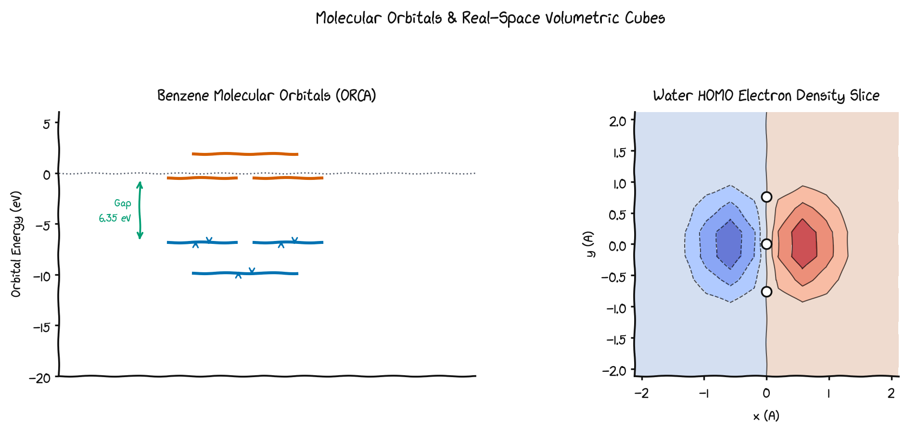
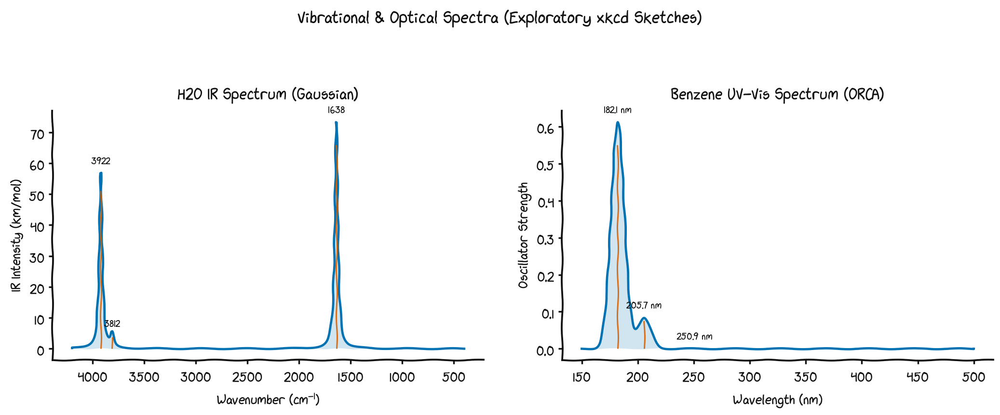
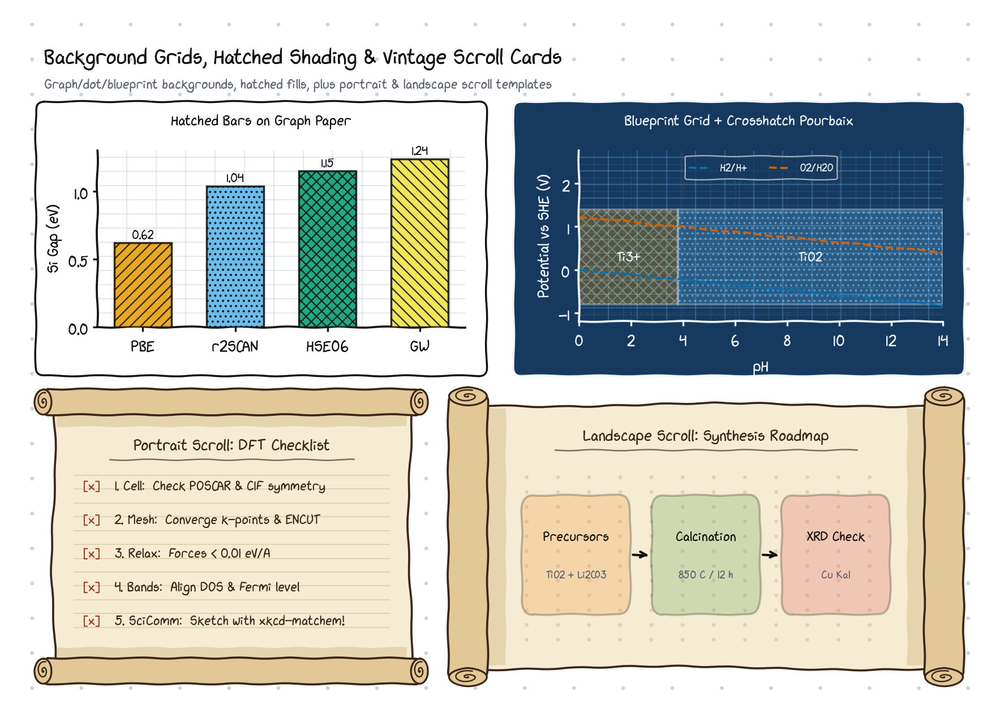

# xkcd-matchem: An xkcd-Style Visualization Suite for Chemistry and Materials Science Communication

[](https://www.python.org/downloads/)
[](LICENSE)
[](LICENSE-DOCS)
[-orange.svg)](THIRD_PARTY_LICENSES.md)

**A more fun — yet crisp and readable — xkcd-style way to view your molecules, crystals, and materials chemistry.**

> **How this started:**
> I have always had fun reading xkcd comics and loved how comic-style fonts and playful sketches make technical ideas feel instantly approachable. While putting together a research poster recently, I wanted my graphs and figures to look lively without becoming messy. What started as a quick helper for that poster grew into `xkcd-matchem` — an open Python toolkit for fellow students, researchers, and scientists to bring a bit of personality to their **science communication (scicomm)**, posters, group talks, and lectures.

---

## See It in Motion

| 3D Coordination Polyhedra Orbit | Climbing-Image NEB Pathway | Live Theme & Palette Switching |
| :---: | :---: | :---: |
|  |  |  |
| *Orbiting $\text{TiO}_6$ coordination octahedra with depth-sorted faces* | *Animating a 9-image $\text{S}_\text{N}2$ reaction path into a looping GIF* | *Switching light, warm paper, and dark chalkboard presets on the fly* |

> **A quick note on scope:** `xkcd-matchem` is built for playful exploration, posters, talks, and scicomm. Because intentional xkcd line wiggle can soften fine peak shoulders or subtle curve features, standard straight-line Matplotlib plots remain the better choice for archival journal figures and quantitative peak fitting.


---

## What Makes It Fun (and Practical)

- **One-line defaults that look clean right away:** Load a molecule, crystal, band structure, or trajectory and plot it immediately on an open white canvas with authentic **`xkcd Script`** typography (CC BY-NC 3.0 for non-commercial/academic use; SIL OFL 1.1 alternates also bundled), seamless two-tone bonds, white specular highlights, and zero clutter.
- **Customize every visual detail:** Swap individual atom colors with a plain Python dict (`{"Ti": "#E07A5F", "O": "#3D405B"}`), create reusable themes (`register_preset`) and color schemes (`register_palette`, `register_element_palette`), pick crystallographic camera angles (`Camera.from_preset`), or restyle your own `plt.subplots()` with `style_existing_axes()`.
- **Spin structures offline in 3D:** Launch the browser-based **Interactive 3D Studio** (`xm.view_structure(...)` or `xkcd-matchem view ...`) directly in Jupyter or as a standalone offline HTML file — rotate, build supercells, tweak colors live, export PNG/SVG, and copy the matching Python code.
- **Zero-dependency built-in readers:** Open 26 common chemistry and materials formats using only **NumPy, SciPy, and Matplotlib**, with optional adapters for **ASE**, **pymatgen**, **RDKit**, **cclib**, **MDAnalysis**, and **MDTraj**.

---

## Visual Tour

| Molecules (3D & 2D) | Crystals, Slabs & Powder XRD |
| :---: | :---: |
|  |  |

| Electronic Bands & DOS | Orbitals & Volumetric Cubes |
| :---: | :---: |
|  |  |

| IR & UV-Vis Spectra | Reaction Profiles & NEB |
| :---: | :---: |
|  |  |

| MD RMSD & Radial Distribution | Convex Hull, EOS & ML Parity |
| :---: | :---: |
|  |  |

| Periodic Table & Property Heatmaps | Materials Informatics (Ternary, Sunburst & KDE) |
| :---: | :---: |
|  |  |

| Background Grids, Hatched Shading & Vintage Scrolls | MatChem Icons & GNN Structure Graphs |
| :---: | :---: |
|  |  |

Putting together a research poster? Opt into `xm.Board`, `Container`, `Card`, `ScrollCard`, and `Badge` for millimeter-accurate layouts — you can group and **stack multiple cards vertically or side by side inside container boxes**:


---

## Installation

Install the core package (requires only Python 3.10+, NumPy, SciPy, and Matplotlib — **15 bundled sample files**, the default `xkcd Script` font, and SIL OFL 1.1 alternates are included):

```bash
pip install xkcd-matchem
```

Add only the optional ecosystem extras you need (`ase`, `pymatgen`, `rdkit`, `qm` for `cclib`, `md` for `MDAnalysis` + `mdtraj`, and `animation` for Pillow GIF export):

```bash
pip install "xkcd-matchem[ase,pymatgen,rdkit,animation]"
```

For local development, tests, and building the Jupyter Book documentation:

```bash
git clone https://github.com/vzordillo/xkcd-matchem.git
cd xkcd-matchem
pip install -e ".[animation,dev,docs]"
```

---

## Quickstart

### Start in One Line (Default Presets)

All filenames below work out of the box using bundled examples — swap in any path to your own simulation files:

```python
import xkcd_matchem as xm

# Molecules, crystals, slabs, and coordination polyhedra
xm.plot_molecule("aspirin.xyz", title="Aspirin 3D")
xm.plot_crystal("si_diamond.cif", miller_planes=[(1, 1, 1)], crystal_axes="corner", title="Si (111)")
xm.plot_slab("tio2_slab.poscar", supercell=(3, 2, 1), view="side")
xm.plot_coordination("tio2_slab.poscar", "Ti", "O", title="TiO2 Coordination Polyhedra")

# Electronic structure, powder XRD, reaction barriers, and animated GIFs
bands = xm.load("si_qe_bands.dat")
dos = xm.load("si_qe_dos.dat")
xm.plot_bands_dos(bands, dos, ylim=(-8.0, 10.0), title="Silicon Bands & DOS")
xm.plot_xrd("nacl.cif", label_peaks=4)
xm.plot_neb(xm.load_trajectory("sn2_neb.xyz"))
xm.animate_trajectory(xm.load_trajectory("sn2_neb.xyz"), "sn2_path.gif", fps=6)

# Periodic table, materials informatics, scrolls, icons, and crystal GNN graphs
xm.plot_periodic_table(element_property="electronegativity", missing_shade="hatch")
xm.plot_spacegroup_distribution({225: 32, 194: 26, 62: 28, 14: 22}, mode="sunburst", shade="cycle")
xm.plot_structure_graph("si_diamond.cif", layout="camera", show_cell=True)
xm.plot_scroll_card("Lab Checklist", items=[("Step 1", "Relax cell"), ("Step 2", "Plot in xkcd")], background_grid="ruled")

# Open the offline Interactive 3D Studio in Jupyter or a browser
xm.view_structure("tio2_slab.poscar", style="polyhedra", polyhedra=("Ti", "O"))
```

### Make It Yours (Custom Themes, Colors & Cameras)

```python
import matplotlib.pyplot as plt
import xkcd_matchem as xm

# 1. Derive reusable custom themes and element color schemes
xm.register_preset(
    "studio_chalk",
    base="dark_chalk",
    sketch_scale=1.1,
    linewidth=2.0,
)
xm.register_element_palette(
    "terracotta",
    {"Ti": "#E07A5F", "O": "#3D405B", "Si": "#F2CC8F"},
    base="pastel",
)

# 2. Override colors inline, pick a camera angle, and decouple crystal axes from the cell box
cam = xm.Camera.from_preset("perspective", zoom=1.15)
ax = xm.plot_crystal(
    "mos2_2h.poscar",
    supercell=(2, 2, 1),
    camera=cam,
    palette={"Mo": "#2A9D8F", "S": "#E9C46A"},
    show_cell=False,
    crystal_axes="corner",
)

# 3. Apply your theme cleanly across custom multi-panel Matplotlib figures
with xm.xkcd_style("studio_chalk", palette=["#F4A261", "#81B29A"]):
    fig, axes = plt.subplots(1, 2, figsize=(10, 4))
    xm.style_existing_axes(axes[0], preset="studio_chalk")
    xm.plot_xrd("si_diamond.cif", ax=axes[0], preset="studio_chalk")
    xm.plot_molecule(
        "alaninedipeptide.pdb",
        ax=axes[1],
        preset="studio_chalk",
        palette="terracotta",
    )
```

### Fonts & Commercial-Safe Alternates

`xkcd-matchem` uses the authentic IPython [`xkcd Script`](https://github.com/ipython/xkcd-font) font (**CC BY-NC 3.0**, non-commercial/academic use) by default across every preset and the Interactive 3D Studio. Need a commercial-safe font or your own local `.ttf`? Switch globally in one line using the bundled **SIL OFL 1.1** fonts (`Patrick Hand` or `Comic Neue`):

```python
import xkcd_matchem as xm

# Switch globally to a bundled SIL OFL 1.1 font (commercial-safe)
xm.set_default_font("Patrick Hand")  # or "Comic Neue"

# Or load any local .ttf / .otf font file
xm.set_default_font("/path/to/MyFont.ttf")

# Reset back to the bundled xkcd Script default anytime
xm.set_default_font(None)
```

---

## Command-Line Interface

Prefer quick terminal renders or instant browser previews? Use the `xkcd-matchem` CLI:

```bash
# Explore bundled examples, supported formats, and structure metadata
xkcd-matchem samples
xkcd-matchem formats
xkcd-matchem info tio2_slab.poscar

# Render static figures with supercells, camera presets, and custom atom colors
xkcd-matchem render tio2_slab.poscar -o tio2.png --supercell 2 1 1 --view perspective --colors Ti=#E07A5F O=#264653
xkcd-matchem xrd si_diamond.cif -o si_xrd.png

# Open a standalone offline Interactive 3D Studio in your browser
xkcd-matchem view mos2_2h.poscar -o mos2_studio.html --supercell 2 2 1 --backend browser
```

---

## Supported Formats

All **26 built-in readers** work with zero extra dependencies beyond NumPy, SciPy, and Matplotlib:

| Domain | Built-in Formats |
| --- | --- |
| **Molecules & Biomolecules** | XYZ / extXYZ, PDB (`MODEL` + `CONECT`), SDF / MOL (V2000), MOL2 |
| **Crystals & Periodic DFT** | VASP (`POSCAR`, `CONTCAR`, `XDATCAR`, `DOSCAR`, `EIGENVAL`, `CHGCAR`, `LOCPOT`), CIF (with symmetry expansion), Quantum ESPRESSO (`pw.in`, `pw.out`, `bands.dat`, `dos.dat`), CP2K `.ener`, xTB `.out` |
| **Molecular Dynamics** | LAMMPS data & `.lammpstrj` (orthogonal + triclinic), GROMACS `.gro` & `.xvg` |
| **Quantum Chem & Grids** | Gaussian `.cube`, `.gjf`, `.log`, `.fchk`, ORCA `.inp`, `.out` |

Need specialized formats outside these built-in readers? Optional bridges to **ASE**, **pymatgen**, **RDKit**, **cclib**, **MDAnalysis**, and **MDTraj** are ready to plug in. See [Supported Formats & Contracts](book/reference/supported_formats.md) for full details.

---

## How to Cite

If `xkcd-matchem` helps you create a poster, lecture slide, tutorial, or outreach figure, please cite it using [`CITATION.cff`](CITATION.cff) (or GitHub's *"Cite this repository"* button; a Zenodo archive DOI can be added upon public release):

> Ordillo, V. (2026). *xkcd-matchem: An xkcd-Style Visualization Suite for Chemistry and Materials Science Communication* (Version 0.1.0) [Computer software]. https://github.com/vzordillo/xkcd-matchem

```bibtex
@software{ordillo2026xkcdmatchem,
  author  = {Ordillo, Viejay},
  title   = {{xkcd-matchem}: An xkcd-Style Visualization Suite for Chemistry and Materials Science Communication},
  year    = {2026},
  version = {0.1.0},
  url     = {https://github.com/vzordillo/xkcd-matchem}
}
```

---

## Acknowledgements

This repository was developed semi-autonomously with **Google DeepMind's Gemini** frontier models inside **[Google Antigravity](https://antigravity.google)**, supported through Google's **Antigravity for Science** academic researcher access program (providing six months of complimentary top-tier Google Antigravity and frontier Gemini access to scientists and academic researchers for non-commercial research). Many thanks to the **Google Antigravity**, **Google Research**, and **Google DeepMind** teams for supporting open scientific exploration and science communication tooling.

---

## Licenses & Scientific Attributions

- **Code**: [Apache License, Version 2.0](LICENSE)
- **Documentation & Tutorials**: [CC BY 4.0](LICENSE-DOCS)
- **Bundled Fonts**: Default **`xkcd Script`** (`ipython/xkcd-font`, derived from Randall Munroe's handwriting) under **CC BY-NC 3.0** (non-commercial/academic use; see [`xkcd-script-LICENSE.txt`](src/xkcd_matchem/data/fonts/xkcd-script-LICENSE.txt)), plus commercial-safe alternates `Patrick Hand` and `Comic Neue` under the **SIL Open Font License 1.1** ([`NOTICE`](NOTICE), [`THIRD_PARTY_LICENSES.md`](THIRD_PARTY_LICENSES.md))
- **Scientific Reference Data**: CODATA 2022 (`Rev. Mod. Phys.` 97, 025002), IUPAC 2021 / CIAAW atomic weights, Blue Obelisk BODR covalent radii, Alvarez (2013) & Mantina et al. (2009) vdW radii, Cromer-Mann (LA-3816) + exact H 1s form factors, Okabe-Ito CUD palette, and Jmol element colors. Full citations live in [Citation & Attributions](book/reference/attributions.md).
