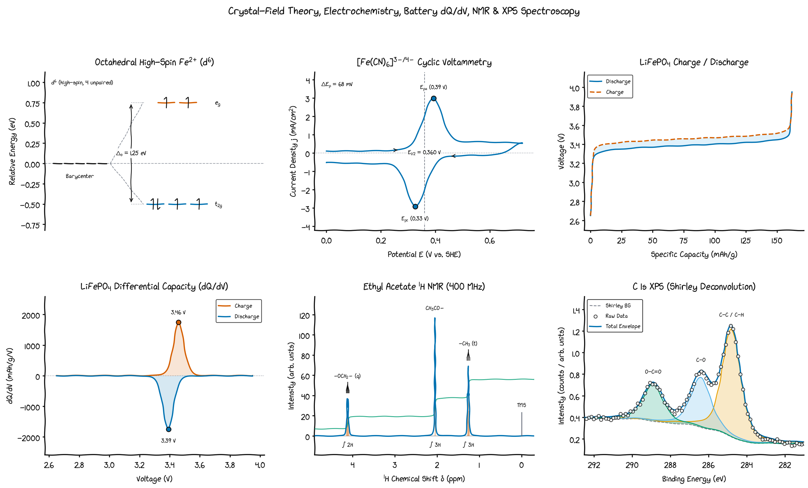

# xkcd-matchem: An xkcd-Style Visualization Suite for Chemistry and Materials Science Communication

[](https://github.com/vzordillo/xkcd-matchem/actions/workflows/ci.yml)
[](https://github.com/vzordillo/xkcd-matchem/actions/workflows/docs.yml)
[](https://mybinder.org/v2/gh/vzordillo/xkcd-matchem/main?urlpath=lab%2Ftree%2Fbook%2Ftutorials%2F01_quickstart_and_themes.ipynb)
[](https://www.python.org/downloads/)
[](LICENSE)

**A clean, approachable xkcd-style Python suite for visualizing molecules, crystals, electronic structure, spectra, reactions, and trajectories — with 29 zero-dependency file readers and an offline Interactive 3D Studio.**

<p align="center">
  <a href="https://vzordillo.github.io/xkcd-matchem/">Documentation</a> &middot;
  <a href="https://vzordillo.github.io/xkcd-matchem/playground.html">Live 3D Studio</a> &middot;
  <a href="https://vzordillo.github.io/xkcd-matchem/gallery.html">Visual Gallery</a> &middot;
  <a href="https://vzordillo.github.io/xkcd-matchem/tutorials/01_quickstart_and_themes.html">Tutorials (01&ndash;14)</a> &middot;
  <a href="https://vzordillo.github.io/xkcd-matchem/reference/api.html">API Reference</a>
</p>

> **Scope:** Built for posters, talks, lectures, and science communication (scicomm) — because intentional xkcd stroke wiggle can soften subtle curve shoulders, use standard straight-line Matplotlib for archival quantitative peak fitting.


---

## Installation & Quickstart

Requires **Python 3.10+**, NumPy, SciPy, and Matplotlib (17 bundled sample datasets and comic-style fonts included; `pip install xkcd-matchem` will be enabled on the first PyPI release):

```bash
pip install git+https://github.com/vzordillo/xkcd-matchem.git

# Optional ecosystem extras (ase, pymatgen, rdkit, qm, md, animation):
pip install "xkcd-matchem[ase,pymatgen,rdkit,animation] @ git+https://github.com/vzordillo/xkcd-matchem.git"
```

### 1. Plot a Crystal & Annotate with a Stick Scientist

All filenames below resolve automatically to bundled samples — swap in any path to your own simulation files:

```python
import xkcd_matchem as xm

ax = xm.plot_crystal("si_diamond.cif", miller_planes=[(1, 1, 1)], crystal_axes="corner", title="Si (111)")
xm.draw_stick_scientist(ax, xy=(0.12, 0.72), scale=0.20, character="ponytail", facing="right", pose="point", speech="Check (111)!")
xm.save_figure(ax.figure, "si_111.png")
```

### 2. Spin a 3D Orbital in the Offline Interactive 3D Studio

```python
import xkcd_matchem as xm

xm.view_structure("water_homo.cube", iso_shade="crosshatch", output="water_studio.html", backend="browser")
```

### Command-Line Quickstart

```bash
xkcd-matchem render tio2_slab.poscar -o tio2.png
xkcd-matchem view mos2_2h.poscar -o mos2_studio.html
```

<details>
<summary>Custom Themes &amp; Commercial-Safe Fonts</summary>

`xkcd-matchem` uses the bundled [`xkcd Script`](https://github.com/ipython/xkcd-font) font (**CC BY-NC 3.0**, non-commercial/academic use) by default. For commercial work, set environment variable `XM_COMMERCIAL_SAFE=1` or switch globally to a bundled **SIL OFL 1.1** font (`Patrick Hand` or `Comic Neue`), and derive reusable custom themes or element palettes:

```python
import xkcd_matchem as xm

xm.set_default_font("Patrick Hand")  # or "Comic Neue", or a local .ttf path
xm.register_preset("my_talk", base="dark_chalk", sketch_scale=1.1)
ax = xm.plot_crystal("mos2_2h.poscar", preset="my_talk", palette={"Mo": "#2A9D8F", "S": "#E9C46A"})
xm.save_figure(ax.figure, "mos2_dark.png")
xm.set_default_font(None)  # reset to bundled xkcd Script default
```

</details>

---

## In Motion & Flagship Highlights

| 3D Coordination Polyhedra Orbit | Climbing-Image NEB Pathway | Live Theme & Palette Switching |
| :---: | :---: | :---: |
|  |  |  |
| *Orbiting TiO₆ octahedra with depth-sorted faces* | *Looping 9-image S<sub>N</sub>2 transition-state path* | *Light, warm paper, and dark chalkboard presets* |

| Pen-and-Ink 3D Orbital Shading Modes | Brillouin Zones, COHP, Volcanos & Defects |
| :---: | :---: |
|  |  |

| Crystal-Field, Electrochemistry, dQ/dV, NMR & XPS | Turnkey SciComm Templates & Comics |
| :---: | :---: |
|  |  |

Explore all 21 figures & 4 animations in the **[Visual Gallery](https://vzordillo.github.io/xkcd-matchem/gallery.html)**.

---

## What You Can Plot

| Domain | What It Plots | Key Entry Points |
| :--- | :--- | :--- |
| **Molecules (3D & 2D)** | Ball-and-stick, spacefill, skeletal stereobonds, force/spin vectors, and bond/angle callouts | `plot_molecule`, `annotate_distance`, `draw_defect_site` |
| **Crystals, Slabs & Polyhedra** | Supercells, `(hkl)` Miller planes, coordination cages, slabs, Brillouin zones, and Wulff shapes | `plot_crystal`, `plot_slab`, `plot_coordination`, `plot_brillouin_zone`, `plot_wulff_shape` |
| **Electronic Structure & Phonons** | Bands, fatbands, DOS, LOBSTER `-pCOHP`, MO ladders, 8-style 3D orbitals, and phonons | `plot_bands_dos`, `plot_cohp`, `plot_mo_diagram`, `plot_isosurface`, `plot_phonon_bands` |
| **Spectroscopy & Diffraction** | Broadened IR/UV-Vis, ¹H NMR multiplet trees, XPS Shirley fits, and Cu Kα₁ powder XRD | `plot_spectrum`, `plot_nmr`, `plot_xps`, `plot_xrd` |
| **Crystal-Field & Electrochemistry** | *d*-orbital splitting diagrams, cyclic voltammetry, Tafel kinetics, battery cycles, and `dQ/dV` | `plot_crystal_field`, `plot_cyclic_voltammetry`, `plot_tafel`, `plot_battery_profile`, `plot_dqdv` |
| **Reactions, MD & Thermodynamics** | Reaction schemes, NEB barriers, MD RMSD/RDF, convex hulls, EOS, Pourbaix, volcanos, and defects | `plot_reaction_scheme`, `plot_neb`, `plot_rdf`, `plot_eos`, `plot_volcano`, `plot_defect_formation` |
| **Informatics & Crystal Graphs** | 118-element periodic tables, ternary hulls, space-group sunbursts, KDE histograms, and GNN graphs | `plot_periodic_table`, `plot_ternary_phase_diagram`, `plot_spacegroup_distribution`, `plot_structure_graph` |
| **3D Studio, Layouts & Comics** | Offline 3D viewer, looping GIFs, SciComm templates, millimeter poster boards, scrolls, and stick scientists | `view_structure`, `animate_trajectory`, `create_graphical_abstract`, `Board`, `draw_stick_scientist` |

---

## Supported Formats & Contributing

All **29 built-in readers** work with zero extra dependencies beyond NumPy, SciPy, and Matplotlib:

| Domain | Built-in Zero-Dependency Formats |
| :--- | :--- |
| **Molecules & Biomolecules** | XYZ / extXYZ, PDB (`MODEL` + `CONECT`), SDF / MOL (V2000 + stereobonds), MOL2 |
| **Crystals & Periodic DFT** | VASP (`POSCAR`/`CONTCAR`, `XDATCAR`, `DOSCAR`, `EIGENVAL`, `PROCAR`, `CHGCAR`/`LOCPOT`), CIF (62 ITA groups), QE (`pw.in`/`out`, `bands.dat`, `dos.dat`), LOBSTER (`COHPCAR`/`COOPCAR`), Phonopy (`band.yaml`), CP2K `.ener`, xTB `.out` |
| **Molecular Dynamics** | LAMMPS data & `.lammpstrj` (orthogonal + triclinic), GROMACS `.gro` & `.xvg` |
| **Quantum Chem & Grids** | Gaussian `.cube`, `.gjf`, `.log`, `.fchk`, ORCA `.inp` & `.out` |

Optional lazy adapters bridge **ASE**, **pymatgen**, **RDKit**, **cclib**, **MDAnalysis**, and **MDTraj** — see **[Supported Formats & Contracts](https://vzordillo.github.io/xkcd-matchem/reference/supported_formats.html)**.
Want to contribute code, tutorials, or report an issue? Read [`CONTRIBUTING.md`](CONTRIBUTING.md) and [`SECURITY.md`](SECURITY.md).

---

## Citation, Acknowledgements & Licenses

If `xkcd-matchem` helps with your poster, talk, or tutorial, please cite it via [`CITATION.cff`](CITATION.cff):

```bibtex
@software{ordillo2026xkcdmatchem,
  author  = {Ordillo, Viejay},
  title   = {{xkcd-matchem}: An xkcd-Style Visualization Suite for Chemistry and Materials Science Communication},
  year    = {2026},
  version = {0.1.0},
  url     = {https://github.com/vzordillo/xkcd-matchem}
}
```

**Acknowledgements:** Developed semi-autonomously with **Google DeepMind's Gemini** frontier models inside **[Google Antigravity](https://antigravity.google)**, supported by Google's **Antigravity for Science** academic researcher access program. Many thanks to the Google Antigravity, Google Research, and Google DeepMind teams for supporting open scientific communication tooling.

- **Code**: [Apache License, Version 2.0](LICENSE) &middot; **Documentation & Tutorials**: [CC BY 4.0](book/LICENSE-CC-BY-4.0.txt)
- **Bundled Fonts**: Default `xkcd Script` under **CC BY-NC 3.0** ([`xkcd-script-LICENSE.txt`](src/xkcd_matchem/data/fonts/xkcd-script-LICENSE.txt)) plus commercial-safe alternates `Patrick Hand` and `Comic Neue` under **SIL OFL 1.1** ([`NOTICE`](NOTICE), [`THIRD_PARTY_LICENSES.md`](THIRD_PARTY_LICENSES.md))
- **Scientific Data & Attributions**: CODATA 2022, IUPAC 2021 / CIAAW 2024, BODR, Alvarez/Mantina vdW radii, Cromer-Mann (LA-3816), Okabe-Ito, and Jmol colors — see **[Citation & Attributions](https://vzordillo.github.io/xkcd-matchem/reference/attributions.html)**.
