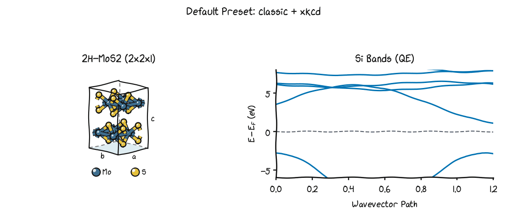
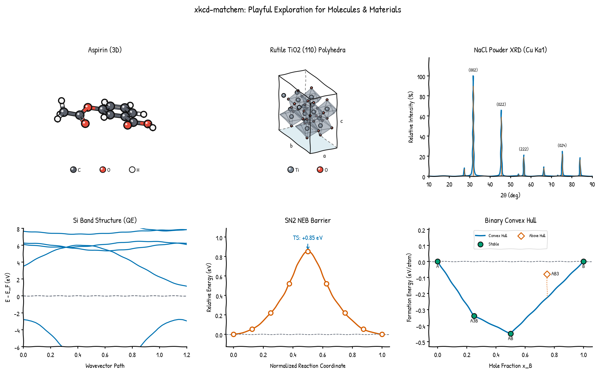
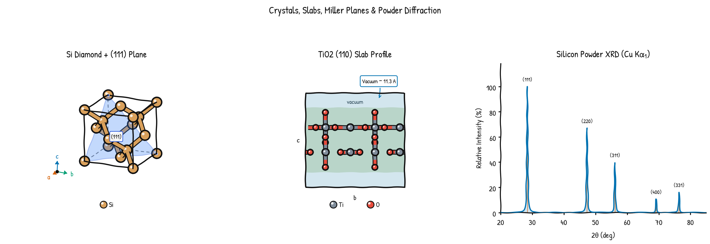
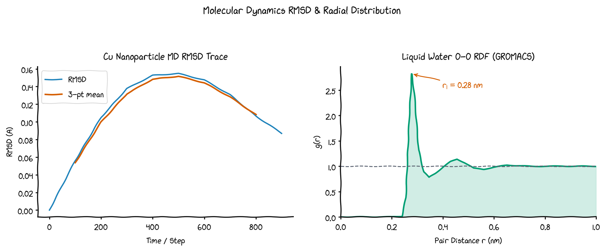
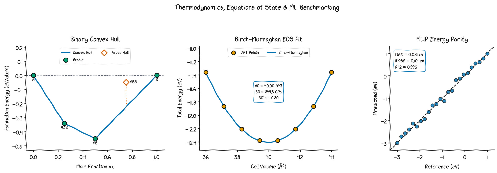

# xkcd-matchem: An xkcd-Style Visualization Suite for Chemistry and Materials Science Communication

[](https://www.python.org/downloads/)
[](LICENSE)
[](LICENSE-DOCS)
[](THIRD_PARTY_LICENSES.md)

**A much more fun — yet crisp and clean-looking — xkcd-style way to explore molecules, crystals, and materials chemistry.**

> **From a Conference Poster Idea to Everyday SciComm:**
> Like many researchers, I have always had fun reading xkcd comics and admired how comic-style fonts and playful graphics make complex ideas click. While preparing a poster recently, the idea came to make my molecules and plots feel livelier without losing clean readability. What started as a small helper for that poster grew into `xkcd-matchem` — a comprehensive open toolkit for fellow students, researchers, and scientists to explore as part of their **science communication (scicomm)**, group meetings, lectures, and posters!

---

## See It in Motion

| 3D Coordination Polyhedra Orbit | Climbing-Image NEB Pathway | Live Style & Palette Switching |
| :---: | :---: | :---: |
|  |  |  |

> *Built for playful intuition, scicomm, talks, and posters: because intentional xkcd line wiggle softens tiny curve features, standard straight-line Matplotlib plots remain the better choice for archival journal spectra and precise numerical peak fitting.*



---

## Built Around Two Simple Ideas

1. **Clean Presets Out of the Box**: Load your structure or simulation file (`aspirin.xyz`, `si_diamond.cif`, `tio2_slab.poscar`, `si_qe_bands.dat`, `sn2_neb.xyz`) and sketch it in one line on a crisp `#FFFFFF` canvas with unified **Patrick Hand** typography (SIL OFL 1.1), split half-bonds, white highlights, and borderless open framing.
2. **Customize Every Detail**: Swap element colors live with inline dictionaries (`{"Ti": "#E07A5F", "O": "#3D405B"}`), register reusable themes (`register_preset`), series palettes (`register_palette`), element palettes (`register_element_palette`), camera viewpoints (`Camera.from_preset`), style your own `plt.subplots()` via `style_existing_axes()`, spin structures in the **offline Interactive 3D Studio** (`xm.view_structure(...)`), or export looping GIFs with `xm.animate_trajectory(...)`.

---

## Visual Tour

| Molecules (3D & 2D) | Crystals, Slabs & Powder XRD |
| :---: | :---: |
|  |  |

| Electronic Bands & DOS | Orbitals & Real-Space Volumetric Cubes |
| :---: | :---: |
|  |  |

| IR & UV-Vis Spectra | Reaction Profiles & NEB |
| :---: | :---: |
|  |  |

| MD RMSD & Radial Distribution | Convex Hull, EOS & ML Parity |
| :---: | :---: |
|  |  |

Preparing a poster like the one that sparked this project? Opt into `xm.Board`, `Container`, `Card`, and `Badge` for millimeter-accurate multi-panel layouts:


---

## Installation

```bash
pip install xkcd-matchem
```

Editable developer installation with test, lint, GIF animation (`pillow`), and Jupyter Book docs tooling:

```bash
git clone https://github.com/vzordillo/xkcd-matchem.git
cd xkcd-matchem
pip install -e ".[animation,dev,docs]"
```

Optional interoperability extras (`ase`, `pymatgen`, `qm` via `cclib`, `rdkit`, `md` via `MDAnalysis` + `mdtraj`, `animation` via `pillow`):

```bash
pip install "xkcd-matchem[ase,pymatgen,rdkit,animation]"
```

---

## Quickstart

### Basic Usage (Clean Default Presets)

```python
import xkcd_matchem as xm

# Molecules and crystals with one function call
xm.plot_molecule("aspirin.xyz", title="Aspirin 3D")
xm.plot_crystal("si_diamond.cif", miller_planes=[(1, 1, 1)], title="Si (111)")
xm.plot_slab("tio2_slab.poscar", supercell=(3, 2, 1), view="side")
xm.plot_coordination("tio2_slab.poscar", "Ti", "O", title="TiO2 Coordination Polyhedra")

# Electronic structure, diffraction, reactions, and GIF animations
bands = xm.load("si_qe_bands.dat")
dos = xm.load("si_qe_dos.dat")
xm.plot_bands_dos(bands, dos, ylim=(-8.0, 10.0), title="Silicon Bands & DOS")
xm.plot_xrd("nacl.cif", label_peaks=4)
xm.plot_neb(xm.load_trajectory("sn2_neb.xyz"))
xm.animate_trajectory(xm.load_trajectory("sn2_neb.xyz"), "sn2_path.gif", fps=6)

# Launch interactive 3D studio right inside Jupyter or your web browser
xm.view_structure("tio2_slab.poscar", style="polyhedra", polyhedra=("Ti", "O"))
```

### Advanced Usage (Customize Everything)

```python
import matplotlib.pyplot as plt
import xkcd_matchem as xm

# 1. Register custom presets & element palettes cleanly
xm.register_preset(
    "studio_chalk",
    base="dark_chalk",
    sketch_scale=1.1,
    linewidth=2.0,
)
xm.register_element_palette(
    "terracotta",
    {"Ti": "#E07A5F", "O": "#3D405B", "Si": "#F2CC8F"},
    base="pastel",
)

# 2. Inline element dict overrides + crystallographic camera presets
cam = xm.Camera.from_preset("perspective", zoom=1.15)
ax = xm.plot_crystal(
    "mos2_2h.poscar",
    supercell=(2, 2, 1),
    camera=cam,
    palette={"Mo": "#2A9D8F", "S": "#E9C46A"},
    show_cell="wireframe",
)

# 3. Style any existing Matplotlib subplot cleanly
with xm.xkcd_style("studio_chalk", palette=["#F4A261", "#81B29A"]):
    fig, axes = plt.subplots(1, 2, figsize=(10, 4))
    xm.style_existing_axes(axes[0], preset="studio_chalk")
    xm.plot_xrd("si_diamond.cif", ax=axes[0], preset="studio_chalk")
    xm.plot_molecule("alaninedipeptide.pdb", ax=axes[1], preset="studio_chalk", palette="terracotta")
```

---

## Command-Line Interface (`xkcd-matchem`)

```bash
xkcd-matchem samples
xkcd-matchem formats
xkcd-matchem info tio2_slab.poscar
xkcd-matchem render tio2_slab.poscar -o tio2.png --supercell 2 1 1 --view perspective --colors Ti=#E07A5F O=#264653
xkcd-matchem view mos2_2h.poscar -o mos2_studio.html --supercell 2 2 1 --backend browser
xkcd-matchem xrd si_diamond.cif -o si_xrd.png
```

---

## Supported Zero-Dependency Formats & Scientific Care

Native parsers require **only NumPy, SciPy, and Matplotlib** across XYZ/extxyz, VASP (`POSCAR`/`CONTCAR`/`CHGCAR`/`LOCPOT`/`XDATCAR`/`DOSCAR`/`EIGENVAL`), CIF (affine symop expansion + `_atom_site_occupancy`), PDB (`MODEL` + `CONECT`), SDF/MOL (V2000), MOL2, Gaussian CUBE/GJF/LOG/FCHK, ORCA INP/OUT, Quantum ESPRESSO `pw.in`/`pw.out`/`bands.dat`/`dos.dat` (explicit cells & strict unit checks), LAMMPS data (explicit or unambiguous styles + `type_map`) & `.lammpstrj` (orthogonal + `xy xz yz` triclinic bounds), GROMACS `.gro`/`.xvg`, CP2K `.ener`, and xTB `.out`.

Geometry and analysis routines enforce LLL-reduced bounded closest-vector minimum-image vectors for triclinic cells, exact spherical-shell periodic RDF normalization, unwrapped MD RMSD, affine-accurate volumetric grid slice meshes, and property-preserving `AtomsData.repeat()` supercells. Optional bridges to **ASE**, **pymatgen**, **RDKit**, **cclib**, **MDAnalysis**, and **MDTraj** handle specialized inputs outside these native subsets. See [Supported Formats & Contracts](book/reference/supported_formats.md) for exact scope details.

---

## How to Cite

If `xkcd-matchem` helps you make a poster, talk, tutorial, or outreach figure, please cite it using the metadata in [`CITATION.cff`](CITATION.cff) (or GitHub's *"Cite this repository"* button; a Zenodo archive DOI can be linked upon public release):

> Ordillo, V. (2026). *xkcd-matchem: An xkcd-Style Visualization Suite for Chemistry and Materials Science Communication* (Version 0.1.0) [Computer software]. https://github.com/vzordillo/xkcd-matchem

```bibtex
@software{ordillo2026xkcdmatchem,
  author  = {Ordillo, Viejay},
  title   = {{xkcd-matchem}: An xkcd-Style Visualization Suite for Chemistry and Materials Science Communication},
  year    = {2026},
  version = {0.1.0},
  url     = {https://github.com/vzordillo/xkcd-matchem}
}
```

---

## Acknowledgements

This repository was developed semi-autonomously with **Google DeepMind's Gemini** frontier models inside **[Google Antigravity](https://antigravity.google)**, supported through Google's **Antigravity for Science** academic researcher access program (providing six months of complimentary top-tier Google Antigravity and frontier Gemini access to scientists and academic researchers for non-commercial research). Many thanks to the **Google Antigravity**, **Google Research**, and **Google DeepMind** teams for empowering scientific exploration and open-source science communication tooling.

---

## Licenses & Scientific Attributions

- **Code**: Licensed under the [Apache License, Version 2.0](LICENSE).
- **Documentation & Tutorials**: Licensed under [CC BY 4.0](LICENSE-DOCS).
- **Bundled Fonts**: `Patrick Hand` and `Comic Neue` under the **SIL Open Font License 1.1** (`NOTICE`, `THIRD_PARTY_LICENSES.md`).
- **Physical Data & Color References**: CODATA 2022 (`Rev. Mod. Phys.` 97, 025002), IUPAC 2021/CIAAW atomic weights, Blue Obelisk BODR covalent radii, Alvarez (2013) & Mantina et al. (2009) vdW radii, Cromer-Mann (LA-3816) + hydrogen 1s form factors, Okabe-Ito CUD palette, and Jmol colors.
