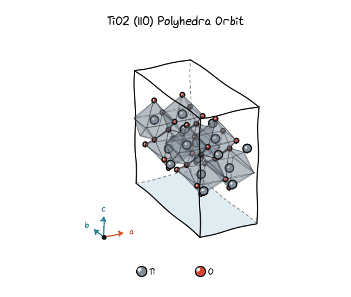
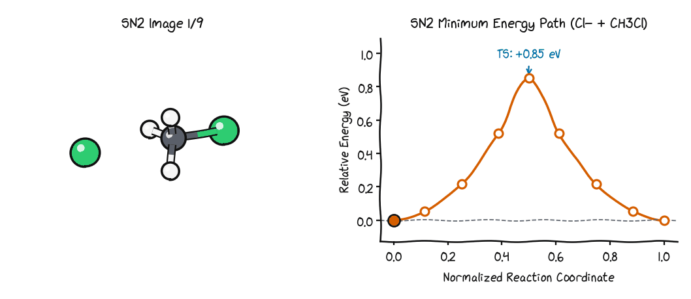
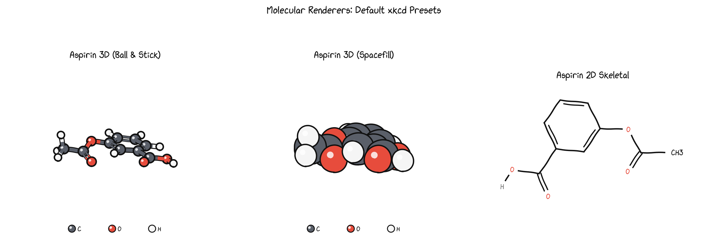
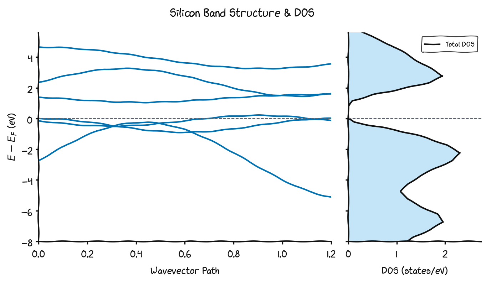
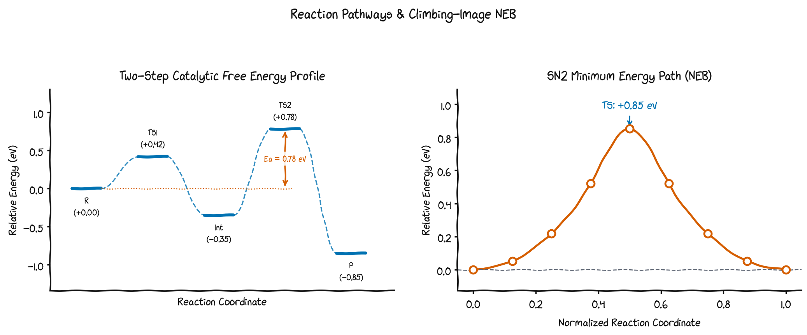
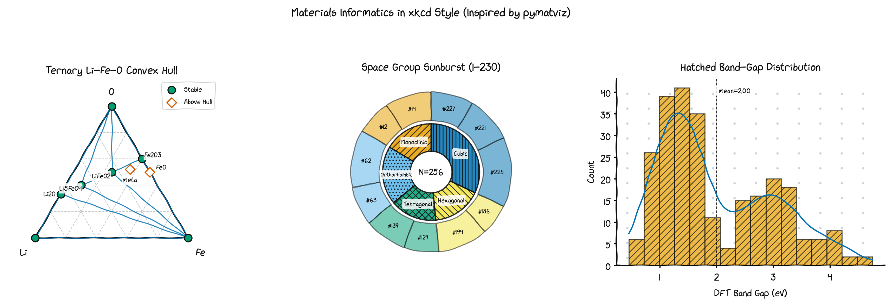
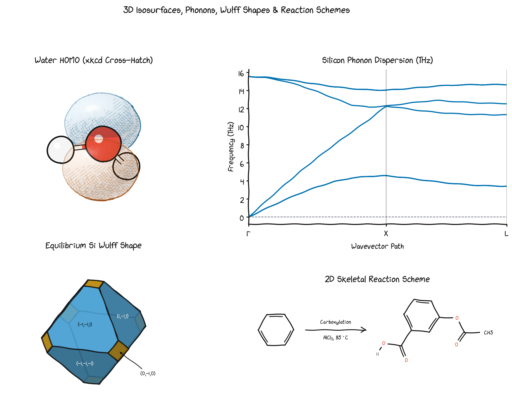
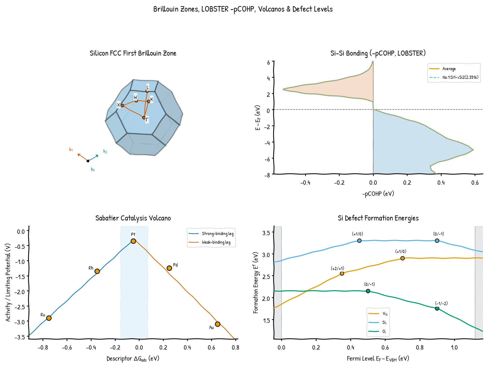
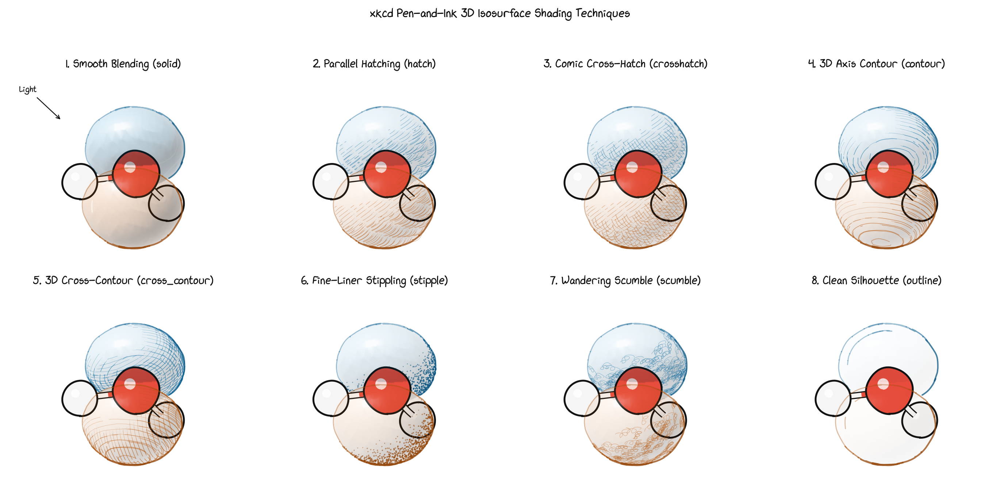
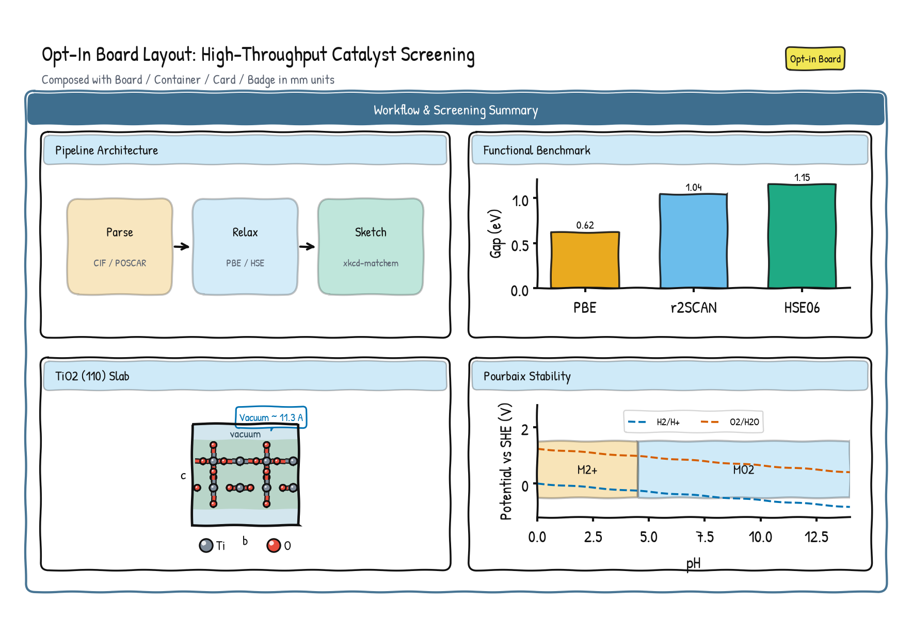

# xkcd-matchem: An xkcd-Style Visualization Suite for Chemistry and Materials Science Communication

[](https://www.python.org/downloads/)
[](LICENSE)
[](book/LICENSE-CC-BY-4.0.txt)
[-orange.svg)](THIRD_PARTY_LICENSES.md)

**A more fun — yet crisp and readable — xkcd-style way to view your molecules, crystals, and materials chemistry.**

> **How this started:**
> I have always had fun reading xkcd comics and loved how comic-style fonts and playful sketches make technical ideas feel instantly approachable. While putting together a research poster recently, I wanted my graphs and figures to look lively without becoming messy. What started as a quick helper for that poster grew into `xkcd-matchem` — an open Python toolkit for fellow students, researchers, and scientists to bring a bit of personality to their **science communication (scicomm)**, posters, group talks, and lectures.

---

## See It in Motion

| 3D Coordination Polyhedra Orbit | Climbing-Image NEB Pathway | Live Theme & Palette Switching |
| :---: | :---: | :---: |
|  |  |  |
| *Orbiting $\text{TiO}_6$ coordination octahedra with depth-sorted faces* | *Animating a 9-image $\text{S}_\text{N}2$ reaction path into a looping GIF* | *Switching light, warm paper, and dark chalkboard presets on the fly* |

> **A quick note on scope:** `xkcd-matchem` is built for playful exploration, posters, talks, and scicomm. Because intentional xkcd line wiggle can soften fine peak shoulders or subtle curve features, standard straight-line Matplotlib plots remain the better choice for archival journal figures and quantitative peak fitting.


---

## What Makes It Fun (and Practical)

- **One-line defaults that look clean right away:** Load a molecule, crystal, band structure, or trajectory and plot it immediately on an open white canvas with authentic **`xkcd Script`** typography (CC BY-NC 3.0 for non-commercial/academic use; SIL OFL 1.1 alternates also bundled), seamless two-tone bonds, white specular highlights, and zero clutter.
- **Customize every visual detail:** Swap individual atom colors with a plain Python dict (`{"Ti": "#E07A5F", "O": "#3D405B"}`), create reusable themes (`register_preset`) and color schemes (`register_palette`, `register_element_palette`), pick crystallographic camera angles (`Camera.from_preset`), or restyle your own `plt.subplots()` with `style_existing_axes()`.
- **Spin structures offline in 3D:** Launch the browser-based **Interactive 3D Studio** (`xm.view_structure(...)` or `xkcd-matchem view ...`) directly in Jupyter or as a standalone offline HTML file — orbit/zoom, scrub multi-frame trajectories, toggle 3D CUBE orbital isosurfaces & force/spin vectors, build supercells, export PNG/SVG, and copy the matching Python code.
- **Zero-dependency built-in readers:** Open 29 common chemistry and materials formats using only **NumPy, SciPy, and Matplotlib**, with optional adapters for **ASE**, **pymatgen**, **RDKit**, **cclib**, **MDAnalysis**, and **MDTraj**.

---

## Visual Tour

| Molecules (3D & 2D) | Crystals, Slabs & Powder XRD |
| :---: | :---: |
|  |  |

| Electronic Bands & DOS | Orbitals & Volumetric Cubes |
| :---: | :---: |
|  |  |

| IR & UV-Vis Spectra | Reaction Profiles & NEB |
| :---: | :---: |
|  |  |

| MD RMSD & Radial Distribution | Convex Hull, EOS & ML Parity |
| :---: | :---: |
|  |  |

| Periodic Table & Property Heatmaps | Materials Informatics (Ternary, Sunburst & KDE) |
| :---: | :---: |
|  |  |

| Background Grids, Hatched Shading & Vintage Scrolls | MatChem Icons & 3D GNN Structure Graphs |
| :---: | :---: |
|  |  |

| Isosurfaces, Phonons, Wulff & Schemes | Brillouin Zones, Volcanos, Defects & COHP |
| :---: | :---: |
|  |  |

| xkcd Pen-and-Ink 3D Shading Modes | xkcd.com Stick Scientists & Comic Strips |
| :---: | :---: |
|  |  |

Want pure atomic lattice sites without bonds (`show_bonds=False`) or **planar flat 2D GNN crystal & periodic quotient multigraphs** (`layout="planar"`, `multi_edges=True`)?


Putting together a research poster? Opt into `xm.Board`, `Container`, `Card`, `ScrollCard`, and `Badge` for millimeter-accurate layouts — you can group and **stack multiple cards vertically or side by side inside container boxes**:



---

## Feature Overview

| Category | Capabilities |
| :--- | :--- |
| **Molecules (3D & 2D)** | Depth-sorted 3D `ball_and_stick`, `spacefill` (van der Waals spheres), and `stick` renderers with seamless two-tone bonds, force/velocity/spin vectors (`vectors=`), and specular highlights; 2D skeletal plots with stereobonds (`wedge`, `dash`, `wavy`), automatic organic double/triple bond perception (`infer_bond_orders`), and inward ring double bonds; optional bond-free atom clouds (`show_bonds=False`); 3D distance, angle & defect/vacancy annotations (`annotate_distance`, `annotate_angle`, `draw_defect_site`). |
| **Crystals, Slabs, Wulff & Polyhedra** | Periodic crystals and supercells (`repeat`, `center_in_cell`); bond-free atomic lattice views (`show_bonds=False`); decoupled unit-cell box (`show_cell`) and standalone VESTA-style corner/origin/edge crystallographic axes (`crystal_axes="corner" \| "origin" \| "edges" \| False`); exact `(hkl)` Miller lattice planes, 3D Wigner–Seitz first Brillouin zones (the reciprocal-space unit cell with high-symmetry **k**-paths: `plot_brillouin_zone`, `compute_brillouin_zone`), & equilibrium 3D Wulff crystal habits minimizing surface energy (`plot_wulff_shape`, `compute_wulff_shape`); bond-free ConvexHull coordination polyhedra (`plot_coordination`); surface slab views with automatic vacuum-gap callouts (`plot_slab`). |
| **Electronic Structure, COHP, Isosurfaces & Phonons** | Band structures with orbital fatband ribbons (`plot_bands`), aligned Band + DOS (`plot_bands_dos`), total/spin-polarized/orbital-projected DOS (`plot_dos`), LOBSTER `-pCOHP`/`-ICOHP` chemical bonding vs. antibonding curves (`plot_cohp`, `read_cohpcar`), molecular orbital HOMO–LUMO ladders (`plot_mo_diagram`), 2D volumetric slices (`plot_volumetric_slice`), pure-NumPy 3D orbital/density isosurfaces (`plot_isosurface` with all 8 shading modes: `shade="solid" \| "hatch" \| "crosshatch" \| "contour" \| "cross_contour" \| "stipple" \| "scumble" \| "outline"`, `extract_isosurface`), and Phonopy lattice-vibration phonon dispersions with imaginary-mode stability highlights (`plot_phonon_bands`). |
| **Spectroscopy & Diffraction** | IR, Raman, UV-Vis, and NMR stick + broadened spectra with true Voigt & area-normalized profiles (`plot_spectrum`, `broaden_peaks`) and occupancy-weighted powder XRD (`plot_xrd`, `compute_xrd`) using Cromer-Mann (LA-3816) + exact H 1s scattering form factors at CODATA 2022 $\text{Cu K}\alpha_1$ (`1.54059313` Å). |
| **Reactions, Catalysis, Defects & Thermodynamics** | Multi-step catalytic free-energy profiles with global/elementary barriers (`plot_reaction_profile`), 2D skeletal reaction equation schemes (`plot_reaction_scheme`), climbing-image Nudged Elastic Band (NEB) transition-state barriers (`plot_neb`), periodic-unwrapped MD RMSD/temperature/pressure time-series (`plot_md_timeseries`, `plot_rmsd`), exact minimum-image radial distribution functions $g(r)$ (`plot_rdf`), binary & ternary convex stability hulls (`plot_phase_diagram_2d`, `plot_ternary_phase_diagram`), third-order Birch-Murnaghan equation-of-state (EOS) bulk-modulus fits (`plot_eos`), electrochemical Pourbaix diagrams (`plot_pourbaix`), Sabatier catalysis volcanos (`plot_volcano`), semiconductor defect formation diagrams with `(q1/q2)` charge-transition kinks (`plot_defect_formation`), and ML parity benchmarks (`plot_parity`). |
| **Periodic Table, Informatics & Graph Networks** | 118-element xkcd Periodic Table (`plot_periodic_table`: chemical families, property heatmaps with hatched missing tiles, formula spotlights); `pymatviz`-inspired space-group sunburst/bar distributions (`plot_spacegroup_distribution`) and hatched KDE histograms (`plot_histogram`); 3D camera-matched GNN crystal graphs, flat planar 2D GNN crystal graphs (`layout="planar"`), periodic quotient multigraphs (`multi_edges=True, show_shift_labels=True`), and synthesis/phase-transformation pill networks (`plot_graph_network`, `plot_structure_graph`). |
| **Themes, Comics, Scrolls & Poster Boards** | 9 built-in presets (`classic`, `notebook`, `poster`, `minimal`, `dark_chalk`, `blueprint`, `talk_16x9`, `talk_dark`, `graphical_abstract`) plus `register_preset`, `register_palette`, `register_element_palette`, and `style_existing_axes`; bundled `xkcd Script` default + SIL OFL 1.1 alternates (`Patrick Hand`, `Comic Neue`, `XM_COMMERCIAL_SAFE=1`); 5 background grids (`ruled`, `graph`, `dotgrid`, `isometric`, `blueprint`); 16 vector MatChem icons & element badges; multi-panel `ComicStrip` / `plot_comic_strip` with speech bubbles and stick scientists; millimeter poster `Board` (`board.save(..., exact_mm=True)`) with stacked `Card`s and vintage parchment `ScrollCard`s. |
| **Interactive 3D Studio 2.0, Motion, I/O & CLI** | Offline browser/Jupyter **Interactive 3D Studio** (`view_structure`, `export_interactive_html`) synced with active/commercial-safe fonts, orbit/zoom/roll, trajectory playback, 3D orbital CUBE isosurfaces, force/spin vectors, live style/palette/axes toggles, supercells, local drag-drop upload, PNG/SVG export, and Copy Python; looping GIF animations (`animate_trajectory`); 29 zero-dependency native file readers + 6 optional ecosystem adapters (`ASE`, `pymatgen`, `RDKit`, `cclib`, `MDAnalysis`, `MDTraj`); `xkcd-matchem` CLI (`samples`, `formats`, `info`, `render`, `view`, `xrd`, `bands`, `dos`, `cohp`, `neb`, `ptable`, `phonon`). |

---

## Installation

Install the core package (requires only Python 3.10+, NumPy, SciPy, and Matplotlib — **17 bundled sample files**, the default `xkcd Script` font, and SIL OFL 1.1 alternates are included):

```bash
pip install xkcd-matchem
```

Add only the optional ecosystem extras you need (`ase`, `pymatgen`, `rdkit`, `qm` for `cclib`, `md` for `MDAnalysis` + `mdtraj`, and `animation` for Pillow GIF export):

```bash
pip install "xkcd-matchem[ase,pymatgen,rdkit,animation]"
```

For local development, tests, and building the Jupyter Book documentation:

```bash
git clone https://github.com/vzordillo/xkcd-matchem.git
cd xkcd-matchem
pip install -e ".[animation,dev,docs]"
```

---

## Quickstart

### Start in One Line (Default Presets)

All filenames below work out of the box using bundled examples — swap in any path to your own simulation files:

```python
import xkcd_matchem as xm

# Molecules, crystals (with or without bonds), slabs, and coordination polyhedra
xm.plot_molecule("aspirin.xyz", title="Aspirin 3D")
xm.plot_crystal("si_diamond.cif", miller_planes=[(1, 1, 1)], crystal_axes="corner", title="Si (111)")
xm.plot_crystal("nacl.cif", show_bonds=False, crystal_axes="corner", title="NaCl Sites Only")
xm.plot_slab("tio2_slab.poscar", supercell=(3, 2, 1), view="side")
xm.plot_coordination("tio2_slab.poscar", "Ti", "O", title="TiO2 Coordination Polyhedra")

# Electronic structure, powder XRD, reaction barriers, and animated GIFs
bands = xm.load("si_qe_bands.dat")
dos = xm.load("si_qe_dos.dat")
xm.plot_bands_dos(bands, dos, ylim=(-8.0, 10.0), title="Silicon Bands & DOS")
xm.plot_xrd("nacl.cif", label_peaks=4)
xm.plot_neb(xm.load_trajectory("sn2_neb.xyz"))
xm.animate_trajectory(xm.load_trajectory("sn2_neb.xyz"), "sn2_path.gif", fps=6)

# Periodic table, materials informatics, scrolls, icons, and 3D/2D crystal GNN graphs
xm.plot_periodic_table(element_property="electronegativity", missing_shade="hatch")
xm.plot_spacegroup_distribution({225: 32, 194: 26, 62: 28, 14: 22}, mode="sunburst", shade="cycle")
xm.plot_structure_graph("si_diamond.cif", layout="camera", show_cell=True)
xm.plot_structure_graph("si_diamond.cif", layout="planar")
xm.plot_scroll_card("Lab Checklist", items=[("Step 1", "Relax cell"), ("Step 2", "Plot in xkcd")], background_grid="ruled")

# Annotate any plot with aspect-invariant xkcd.com stick scientists
ax_def = xm.plot_defect_formation({"V_Si": [(2, 2.0), (1, 2.35), (0, 3.05)]})
xm.draw_stick_scientist(ax_def, xy=(0.86, 0.08), character="ponytail", facing="left", pose="think", speech="Check (+1/0)!")

# Open the offline Interactive 3D Studio in Jupyter or a browser
xm.view_structure("tio2_slab.poscar", style="polyhedra", polyhedra=("Ti", "O"))
```

### Make It Yours (Custom Themes, Colors & Cameras)

```python
import matplotlib.pyplot as plt
import xkcd_matchem as xm

# 1. Derive reusable custom themes and element color schemes
xm.register_preset(
    "studio_chalk",
    base="dark_chalk",
    sketch_scale=1.1,
    linewidth=2.0,
)
xm.register_element_palette(
    "terracotta",
    {"Ti": "#E07A5F", "O": "#3D405B", "Si": "#F2CC8F"},
    base="pastel",
)

# 2. Override colors inline, pick a camera angle, and decouple crystal axes from the cell box
cam = xm.Camera.from_preset("perspective", zoom=1.15)
ax = xm.plot_crystal(
    "mos2_2h.poscar",
    supercell=(2, 2, 1),
    camera=cam,
    palette={"Mo": "#2A9D8F", "S": "#E9C46A"},
    show_cell=False,
    crystal_axes="corner",
)

# 3. Apply your theme cleanly across custom multi-panel Matplotlib figures
with xm.xkcd_style("studio_chalk", palette=["#F4A261", "#81B29A"]):
    fig, axes = plt.subplots(1, 2, figsize=(10, 4))
    xm.style_existing_axes(axes[0], preset="studio_chalk")
    xm.plot_xrd("si_diamond.cif", ax=axes[0], preset="studio_chalk")
    xm.plot_molecule(
        "alaninedipeptide.pdb",
        ax=axes[1],
        preset="studio_chalk",
        palette="terracotta",
    )
```

### Fonts & Commercial-Safe Alternates

`xkcd-matchem` uses the authentic IPython [`xkcd Script`](https://github.com/ipython/xkcd-font) font (**CC BY-NC 3.0**, non-commercial/academic use) by default across every preset and the Interactive 3D Studio. Need a commercial-safe font or your own local `.ttf`? Switch globally in one line using the bundled **SIL OFL 1.1** fonts (`Patrick Hand` or `Comic Neue`):

```python
import xkcd_matchem as xm

# Switch globally to a bundled SIL OFL 1.1 font (commercial-safe)
xm.set_default_font("Patrick Hand")  # or "Comic Neue"

# Or load any local .ttf / .otf font file
xm.set_default_font("/path/to/MyFont.ttf")

# Reset back to the bundled xkcd Script default anytime
xm.set_default_font(None)
```

---

## Command-Line Interface

Prefer quick terminal renders or instant browser previews? Use the `xkcd-matchem` CLI:

```bash
# Explore bundled examples, supported formats, and structure metadata
xkcd-matchem samples
xkcd-matchem formats
xkcd-matchem info tio2_slab.poscar

# Render static figures with supercells, camera presets, and custom atom colors
xkcd-matchem render tio2_slab.poscar -o tio2.png --supercell 2 1 1 --view perspective --colors Ti=#E07A5F O=#264653
xkcd-matchem xrd si_diamond.cif -o si_xrd.png
xkcd-matchem phonon si_phonon_bands.yaml -o si_phonon.png
xkcd-matchem ptable -o ptable.png --property electronegativity

# Open a standalone offline Interactive 3D Studio in your browser
xkcd-matchem view mos2_2h.poscar -o mos2_studio.html --supercell 2 2 1 --backend browser
```

---

## Supported Formats

All **29 built-in readers** work with zero extra dependencies beyond NumPy, SciPy, and Matplotlib:

| Domain | Built-in Formats |
| --- | --- |
| **Molecules & Biomolecules** | XYZ / extXYZ, PDB (`MODEL` + `CONECT`), SDF / MOL (V2000 + stereobonds), MOL2 |
| **Crystals & Periodic DFT** | VASP (`POSCAR`, `CONTCAR`, `XDATCAR`, `DOSCAR`, `EIGENVAL`, `PROCAR`, `CHGCAR`, `LOCPOT`, `AECCAR0`/`2`), LOBSTER (`COHPCAR.lobster`, `COOPCAR.lobster`), CIF (multi-block + 61-group ITA symmetry with Origin Choice 1/2 for `Fd-3m`), Phonopy (`band.yaml`), Quantum ESPRESSO (`pw.in`, `pw.out`, `bands.dat`, `dos.dat`), CP2K `.ener`, xTB `.out` |
| **Molecular Dynamics** | LAMMPS data & `.lammpstrj` (orthogonal + triclinic), GROMACS `.gro` & `.xvg` |
| **Quantum Chem & Grids** | Gaussian `.cube`, `.gjf`, `.log`, `.fchk`, ORCA `.inp`, `.out` |

Need specialized formats outside these built-in readers? Optional bridges to **ASE**, **pymatgen**, **RDKit**, **cclib**, **MDAnalysis**, and **MDTraj** are ready to plug in. See [Supported Formats & Contracts](book/reference/supported_formats.md) for full details.

---

## Repository Architecture & How to Navigate

The codebase is split into seven focused subpackages under `src/xkcd_matchem/`, accompanied by an executable Jupyter Book (`book/`), a gallery generator (`scripts/`), and a self-contained test suite (`tests/`):

```text
xkcd-matchem/
├── src/xkcd_matchem/
│   ├── __init__.py          # Lazy PEP 562 public API (`import xkcd_matchem as xm`)
│   ├── cli.py               # `xkcd-matchem` CLI (`samples`, `formats`, `info`, `render`, `view`, `xrd`, `bands`, `dos`, `cohp`, `neb`, `ptable`, `phonon`)
│   ├── core/                # Scientific data models & geometry (zero Matplotlib imports)
│   │   ├── structure.py     #   AtomsData (occupancies, magnetic_moments), Bond (stereo), supercells
│   │   ├── geometry.py      #   Camera, 3D projections, LLL minimum-image PBC, Miller planes
│   │   ├── brillouin.py     #   Wigner-Seitz 3D first Brillouin zone solver & k-paths
│   │   ├── neighbors.py     #   cKDTree periodic neighbor search on LLL-reduced triclinic cells
│   │   ├── bonding.py       #   Periodic bond inference, organic bond-order perception, polyhedra
│   │   ├── electronic.py    #   BandStructure, PhononBandStructure, DensityOfStates, CohpData, MOs, VolumetricGrid
│   │   ├── isosurface.py    #   Pure-NumPy Kuhn 6-tetrahedra Marching Tetrahedra mesh extractor
│   │   ├── wulff.py         #   Symmetry-aware HalfspaceIntersection 3D Wulff shape solver
│   │   ├── spectroscopy.py  #   Voigt/Lorentzian/Gaussian broadening & Cromer-Mann XRD engine
│   │   ├── trajectory.py    #   Trajectory, unwrapped RMSD, exact periodic RDF
│   │   └── exceptions.py    #   Custom error hierarchy
│   ├── data/                # Verified scientific tables, spacegroups, samples, fonts & HTML
│   │   ├── elements.py      #   CODATA 2022, 118-element IUPAC/CIAAW/BODR/Alvarez/Mantina table
│   │   ├── scattering.py    #   Cromer-Mann (LA-3816) + exact H 1s form factors
│   │   ├── spacegroups.py   #   Generator-closure ITA symmetry table (61 space groups, Origin 1/2 for Fd-3m)
│   │   ├── samples_registry.py # Registry and lookup helpers for the 17 bundled sample datasets
│   │   ├── samples/         #   17 ready-to-run molecules, crystals, DFT, LOBSTER, MD, Phonopy & cube files
│   │   ├── fonts/           #   Bundled `xkcd Script` (CC BY-NC 3.0) + `Patrick Hand` / `Comic Neue` (OFL)
│   │   └── templates/       #   Offline HTML5/Canvas/SVG template (`viewer.html`) for 3D Studio
│   ├── io/                  # Format auto-detection, 29 native parsers & optional adapters
│   │   ├── loader.py        #   Unified `load()`, `load_trajectory()`, `save()`
│   │   ├── native/          #   Zero-dependency VASP, LOBSTER, Phonopy, CIF, QE, XYZ, PDB, SDF, LAMMPS, ...
│   │   └── adapters/        #   Optional lazy bridges (ASE, pymatgen, RDKit, cclib, MDAnalysis, MDTraj)
│   ├── style/               # Themes, palettes, fonts, background grids & hatched shading
│   │   ├── theme.py         #   `xkcd_style()` context manager, 9 presets, `register_preset()`
│   │   ├── fonts.py         #   Font registration, `set_default_font()`, `XM_COMMERCIAL_SAFE`, warnings
│   │   ├── palettes.py      #   Okabe-Ito, Jmol, xkcd, pastel & colorblind schemes
│   │   └── patterns.py      #   Grid papers (`ruled`/`graph`/`dotgrid`/`isometric`/`blueprint`) & hatched fills
│   ├── render/              # Low-level 2D/3D drawing primitives, icons & interactive viewer
│   │   ├── primitives.py    #   Shaded spheres, vectors, coaxial bonds, dark-theme contrast, unit cell
│   │   ├── artistic3d.py    #   Pen-and-ink 3D isosurface shading (`hatch`, `crosshatch`, `contour`, `stipple`, `scumble`, ...)
│   │   ├── structure3d.py   #   Depth-sorted 3D painter's-algorithm renderer & force/spin vectors
│   │   ├── structure2d.py   #   2D skeletal molecular renderer with stereobonds & inward ring bonds
│   │   ├── callouts.py      #   Element legends, curved arrows, distance/angle & defect callouts
│   │   ├── icons.py         #   16 vector MatChem icons & element badges
│   │   └── interactive.py   #   Jupyter & standalone HTML exporter (frames, CUBE orbitals, vectors)
│   ├── plots/               # High-level one-line domain plotters
│   │   ├── structure.py     #   `plot_molecule`, `plot_crystal`, `plot_slab`, `plot_coordination`
│   │   ├── electronic.py    #   `plot_bands`, `plot_cohp`, `plot_dos`, `plot_bands_dos`, `plot_mo_diagram`, `plot_volumetric_slice`, `plot_isosurface`, `plot_phonon_bands`
│   │   ├── spectroscopy.py  #   `plot_spectrum`, `plot_xrd`
│   │   ├── reactions.py     #   `plot_reaction_profile`, `plot_reaction_scheme`, `plot_neb`
│   │   ├── trajectory.py    #   `plot_md_timeseries` (rmsd/energy/temp/pressure), `plot_rmsd`, `plot_rdf`, `animate_trajectory`
│   │   ├── thermo.py        #   `plot_phase_diagram_2d`, `plot_eos`, `plot_pourbaix`, `plot_volcano`, `plot_defect_formation`
│   │   ├── ptable.py        #   `plot_periodic_table` (118-element families, heatmaps, spotlights)
│   │   ├── materials.py     #   `plot_ternary_phase_diagram`, `plot_spacegroup_distribution`, `plot_histogram`, `plot_wulff_shape`, `plot_brillouin_zone`
│   │   ├── graphs.py        #   `plot_graph_network`, `plot_structure_graph` (3D camera & flat 2D planar)
│   │   └── charts.py        #   `plot_parity`, `plot_bar_comparison`, `plot_pipeline_diagram`
│   └── layout/              # Opt-in poster boards, comic strips, parchment scrolls & export
│       ├── canvas.py        #   `Board` (`board.save(..., exact_mm=True)`), `Container`, `Card`, `Badge` (mm coords)
│       ├── comic.py         #   `ComicPanel`, `ComicStrip`, `draw_speech_bubble`, `draw_stick_scientist`, `plot_comic_strip`
│       ├── scroll.py        #   Portrait & landscape vintage parchment `ScrollCard` templates
│       └── export.py        #   `save_figure()` (PNG, SVG, PDF)
├── book/                    # Jupyter Book documentation (13 executable tutorials + reference + 3D playground)
│   ├── tutorials/           #   Step-by-step notebooks `01_...` through `13_...`
│   ├── reference/           #   API reference, supported formats & scientific attributions
│   └── _static/             #   Generated gallery PNGs/GIFs & embedded `interactive_studio.html`
├── scripts/
│   └── generate_gallery.py  # Reproduces every gallery PNG, GIF, and the offline 3D Studio HTML
└── tests/                   # Pytest unit, visual smoke & Google-style AST compliance tests
```

### Quick Navigation Guide

| If you want to… | Start here |
| :--- | :--- |
| **Learn by runnable examples** | Open [`book/tutorials/`](book/tutorials/) (`01`–`04` & `06` for basics; `05`, `07`–`13` for advanced topics) |
| **Spin crystals right in a browser** | Open [`book/_static/interactive_studio.html`](book/_static/interactive_studio.html) or run `xm.view_structure("tio2_slab.poscar")` |
| **Look up a plotting function** | See [`book/reference/api.md`](book/reference/api.md) or browse [`src/xkcd_matchem/plots/`](src/xkcd_matchem/plots/) |
| **Check file parser rules or add a reader** | See [`book/reference/supported_formats.md`](book/reference/supported_formats.md) and [`src/xkcd_matchem/io/native/`](src/xkcd_matchem/io/native/) |
| **Tweak themes, fonts, grids, or hatching** | Edit [`src/xkcd_matchem/style/`](src/xkcd_matchem/style/) (`theme.py`, `fonts.py`, `palettes.py`, `patterns.py`) |
| **Inspect 3D geometry, bonds, or Miller math** | Check [`src/xkcd_matchem/core/`](src/xkcd_matchem/core/) (`geometry.py`, `neighbors.py`, `bonding.py`) and [`src/xkcd_matchem/render/`](src/xkcd_matchem/render/) |
| **Regenerate all gallery PNGs & GIFs** | Run `python scripts/generate_gallery.py` |
| **Run linters, tests, and docs locally** | `ruff check . --no-cache && pylint src/xkcd_matchem && mypy src/xkcd_matchem && pytest --cov=xkcd_matchem --cov-fail-under=90 && jupyter-book build book/ -W` |

---

## How to Cite

If `xkcd-matchem` helps you create a poster, lecture slide, tutorial, or outreach figure, please cite it using [`CITATION.cff`](CITATION.cff) (or GitHub's *"Cite this repository"* button; a Zenodo archive DOI can be added upon public release):

> Ordillo, V. (2026). *xkcd-matchem: An xkcd-Style Visualization Suite for Chemistry and Materials Science Communication* (Version 0.1.0) [Computer software]. https://github.com/vzordillo/xkcd-matchem

```bibtex
@software{ordillo2026xkcdmatchem,
  author  = {Ordillo, Viejay},
  title   = {{xkcd-matchem}: An xkcd-Style Visualization Suite for Chemistry and Materials Science Communication},
  year    = {2026},
  version = {0.1.0},
  url     = {https://github.com/vzordillo/xkcd-matchem}
}
```

---

## Acknowledgements

This repository was developed semi-autonomously with **Google DeepMind's Gemini** frontier models inside **[Google Antigravity](https://antigravity.google)**, supported through Google's **Antigravity for Science** academic researcher access program (providing six months of complimentary top-tier Google Antigravity and frontier Gemini access to scientists and academic researchers for non-commercial research). Many thanks to the **Google Antigravity**, **Google Research**, and **Google DeepMind** teams for supporting open scientific exploration and science communication tooling.

---

## Licenses & Scientific Attributions

- **Code**: [Apache License, Version 2.0](LICENSE)
- **Documentation & Tutorials**: [CC BY 4.0](book/LICENSE-CC-BY-4.0.txt)
- **Bundled Fonts**: Default **`xkcd Script`** (`ipython/xkcd-font`, derived from Randall Munroe's handwriting) under **CC BY-NC 3.0** (non-commercial/academic use; see [`xkcd-script-LICENSE.txt`](src/xkcd_matchem/data/fonts/xkcd-script-LICENSE.txt)), plus commercial-safe alternates `Patrick Hand` and `Comic Neue` under the **SIL Open Font License 1.1** ([`NOTICE`](NOTICE), [`THIRD_PARTY_LICENSES.md`](THIRD_PARTY_LICENSES.md))
- **Scientific Reference Data**: CODATA 2022 (Mohr et al., 2025, `Rev. Mod. Phys.` 97, 025002), IUPAC 2021 / CIAAW 2024 atomic weights, Blue Obelisk BODR covalent radii, Alvarez (2013) & Mantina et al. (2009) vdW radii, Cromer-Mann (LA-3816) + exact H 1s form factors, Okabe-Ito CUD palette, and Jmol element colors. Full citations live in [Citation & Attributions](book/reference/attributions.md).
