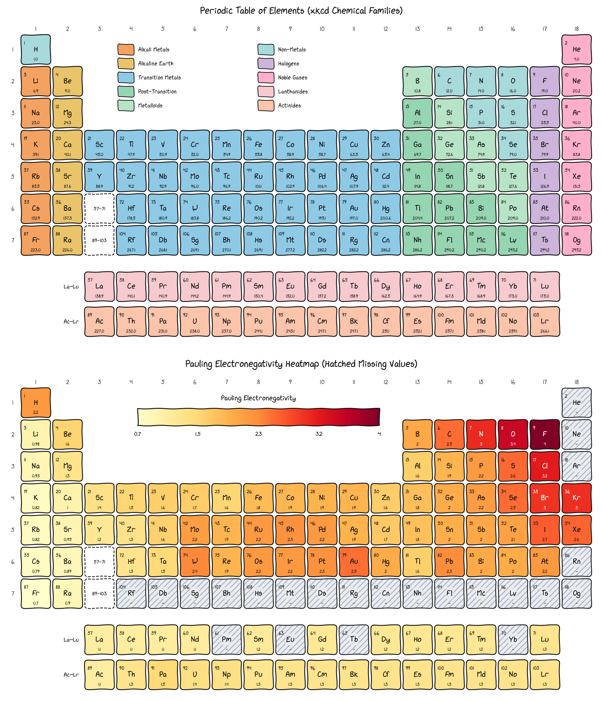
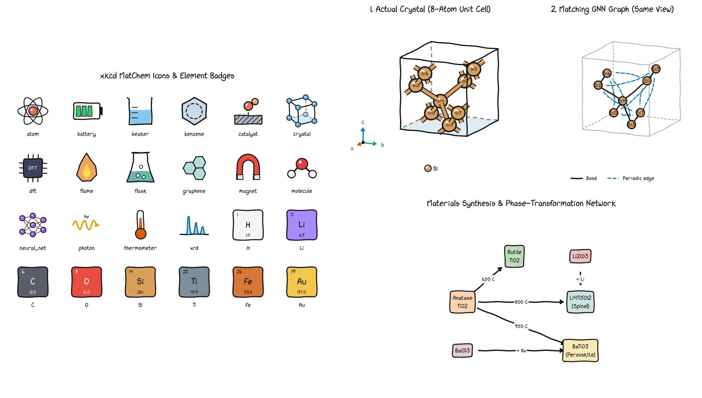
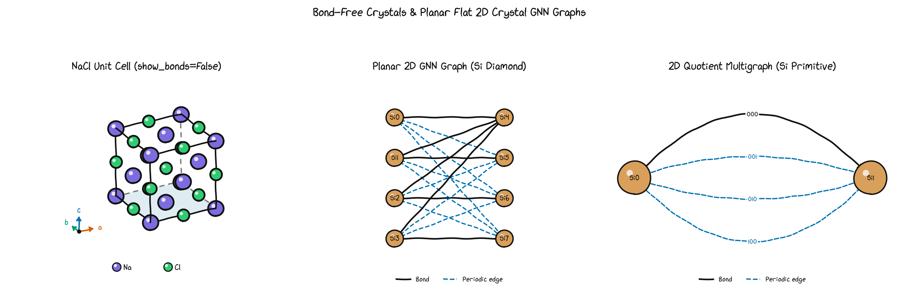
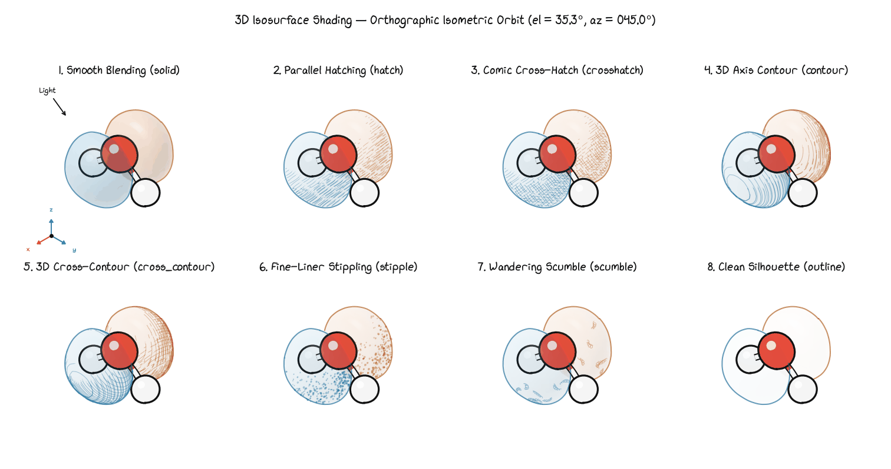
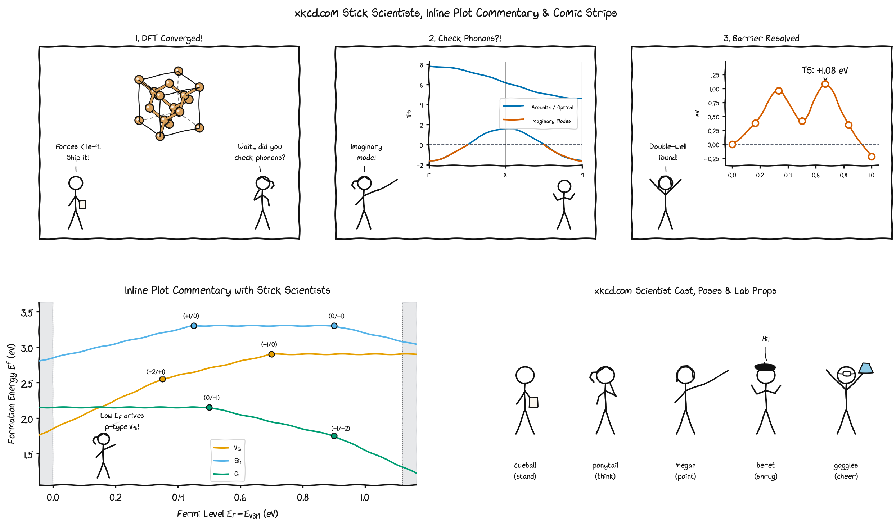
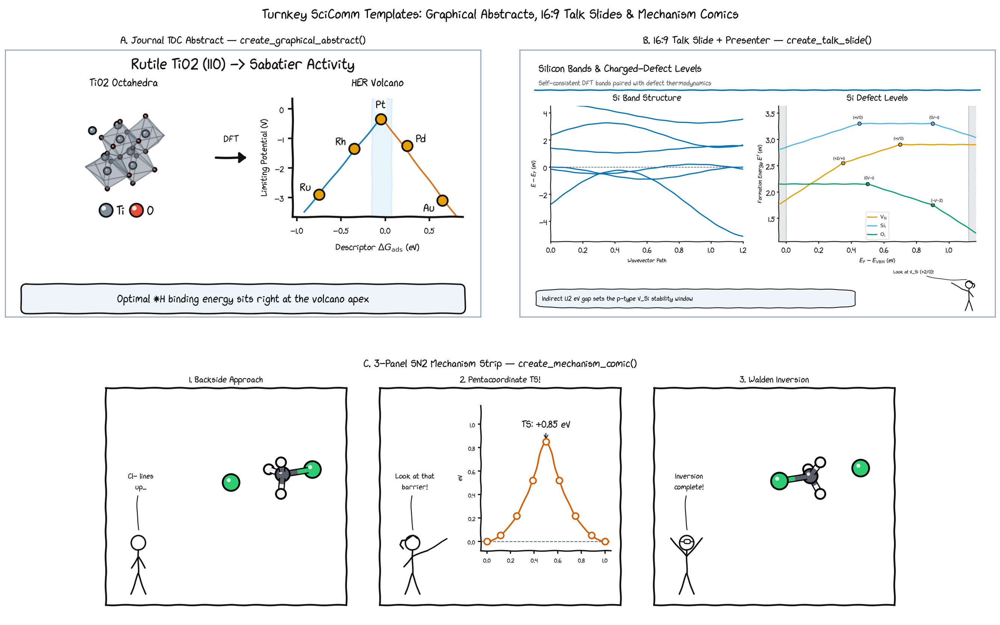

# Visual Gallery

Every figure and animated GIF below is generated automatically by `scripts/generate_gallery.py` using real bundled sample files, unified `xkcd Script` typography, and depth-sorted 3D scenes. Click any tutorial link to see the exact code behind each plot.

## Animated Motion & Theme Explorer

Looping GIFs are rendered with `xm.animate_trajectory()` (requires `pip install "xkcd-matchem[animation]"`) or custom camera/preset loops:

| 3D Coordination Polyhedra Orbit | Climbing-Image NEB Pathway | Live Theme & Palette Switching |
| :---: | :---: | :---: |
|  |  |  |

## Full Multi-Domain Showcase

A quick overview spanning molecules, periodic crystals, electronic structure, spectroscopy, and thermodynamics in one view:

## Molecules: 3D Ball-and-Stick, Spacefill & 2D Skeletal

Compare `plot_molecule(..., style="ball_and_stick")`, `style="spacefill"` (van der Waals spheres illustrating steric bulk), and `mode="2d"` with seamless two-tone bonds, automatic organic bond-order perception (ring and carbonyl double bonds), and inline element legends.
See [Tutorial 02: Molecules in 3D, 2D & Interactive Studio](tutorials/02_molecules_3d_and_2d.ipynb).

## Crystals, Slabs, Miller Planes & Powder XRD

Combine `plot_crystal()` with `(111)` Miller lattice planes (slices cutting cleanly across the repeating unit cell) and supercells, `plot_slab(..., view="side")` (automatic shaded slab/vacuum band detection for $\text{TiO}_2(110)$), `plot_coordination()` (highlighting $\text{TiO}_6$ octahedral ligand cages), and pure-NumPy $\text{Cu K}\alpha_1$ powder diffraction via `plot_xrd()`.
See [Tutorial 03: Crystals, Slabs & Polyhedra](tutorials/03_crystals_slabs_and_polyhedra.ipynb).

## Electronic Band Structure & Density of States

Fermi-aligned silicon bands (allowed electron energies traced along crystal momentum paths) paired with its electronic density of states (how many states sit at each energy), parsed natively from Quantum ESPRESSO `bands.dat` and `dos.dat` via `plot_bands_dos()`.
See [Tutorial 04: Electronic Band Structures & DOS](tutorials/04_electronic_structure_bands_dos.ipynb).

## Molecular Orbitals & Volumetric Charge Density

Pair ORCA molecular orbital energy ladders (`plot_mo_diagram()`, highlighting the HOMO–LUMO energy gap between the highest filled and lowest empty orbitals) with affine-accurate 2D slices of Gaussian `.cube` 3D volumetric grids (`plot_volumetric_slice()`).
See [Tutorial 05: Molecular Orbitals & Volumetric Cubes](tutorials/05_orbitals_and_volumetric_cubes.ipynb).

## IR & UV-Vis Spectra (Exploratory Sketches)

Visualize Gaussian harmonic vibrational IR transitions and ORCA TDDFT electronic UV-Vis absorption peaks with `plot_spectrum()` and customizable line broadening.
See [Tutorial 06: Spectroscopy & Powder XRD](tutorials/06_spectroscopy_and_powder_xrd.ipynb).

## Reaction Energy Profiles & Climbing-Image NEB

Sketch multi-step catalytic energy landscapes (`plot_reaction_profile()`) alongside Nudged Elastic Band (NEB) minimum-energy pathways (`plot_neb()`) that trace the saddle-point transition-state barrier between reactants and products in eV, kJ/mol, or kcal/mol.
See [Tutorial 07: Reaction Pathways & NEB](tutorials/07_reaction_pathways_and_neb.ipynb).

## Molecular Dynamics RMSD & Radial Distribution

Plot periodic-unwrapped MD structural drift traces (`plot_md_timeseries()`) and radial distribution functions $g(r)$ (`plot_rdf()`, where peaks reveal first- and second-neighbor solvation or coordination shells) from LAMMPS and GROMACS outputs.
See [Tutorial 08: MD Trajectories & RDF](tutorials/08_md_trajectories_and_rdf.ipynb).

## Convex Hull, Equations of State & ML Parity

Bring together binary stability hulls (`plot_phase_diagram_2d()`, separating stable ground-state compounds from unstable ones above the hull), third-order Birch-Murnaghan equation-of-state fits (`plot_eos()`, extracting equilibrium volume $V_0$ and bulk modulus $B_0$ stiffness), and ML interatomic potential parity benchmarks (`plot_parity()`).
See [Tutorial 09: Thermodynamics & ML Parity](tutorials/09_thermodynamics_and_ml_parity.ipynb).

## Opt-In Poster Composition (`Board`, `Container`, `Card`, `Badge`)

Individual plots always stay borderless on an open canvas. When assembling a full conference poster or group-meeting handout in millimeter coordinates, opt into `xm.Board` — you can group and **stack multiple cards vertically or side by side inside container boxes**. See [Tutorial 10: Opt-In Poster Boards & Interoperability](tutorials/10_posters_boards_and_interoperability.ipynb):

## Periodic Table of Elements & Property Heatmaps

Render all 118 elements by chemical family, map custom datasets or built-in atomic properties (`electronegativity`, `covalent_radius`, `vdw_radius`, `atomic_mass`) with hatched missing tiles, or spotlight formulas like `"LiFePO4"` using `plot_periodic_table()`.
See [Tutorial 11: Periodic Table, Scrolls, Grids, Icons & Graphs](tutorials/11_periodic_table_scrolls_and_informatics.ipynb).

## Materials Informatics (Ternary Hulls, Space Group Sunbursts & Histograms)

Inspired by `pymatviz`, explore ternary Gibbs convex hulls (`plot_ternary_phase_diagram()`, showing stable three-element phases and tie-lines), two-ring crystal-system/space-group sunbursts (`plot_spacegroup_distribution()`), and hatched property histograms with KDE overlays (`plot_histogram()`).
See [Tutorial 11: Periodic Table, Scrolls, Grids, Icons & Graphs](tutorials/11_periodic_table_scrolls_and_informatics.ipynb).

## Background Grids, Hatched Shading & Vintage Scroll Cards

Layer notebook/graph/dotgrid/isometric/blueprint paper backgrounds (`background_grid=`, `apply_background_grid()`, `clear_background_grid()`), hatched or stippled fills (`shade="cycle" | "crosshatch" | "dots"`), and portrait or landscape vintage parchment scroll cards (`plot_scroll_card()`, `board.add_scroll_card()`) with notebook-style line/grid text alignment (`align_to_grid=True`, `card.write_line()`) or clean grid-free parchment (`background_grid=None`).
See [Tutorial 11: Periodic Table, Scrolls, Grids, Icons & Graphs](tutorials/11_periodic_table_scrolls_and_informatics.ipynb).

## xkcd MatChem Icons, Element Badges & GNN Structure Graphs

Drop playful vector icons (`flask`, `crystal`, `battery`, `graphene`, `catalyst`, `dft`, `neural_net`, and 9 more) and element badges (`draw_element_badge()`) onto any figure, or turn molecules and periodic crystals into Graph Neural Network (GNN) structure graphs with dashed periodic boundary arcs (`plot_structure_graph()`, `plot_graph_network()`).
See [Tutorial 11: Periodic Table, Scrolls, Grids, Icons & Graphs](tutorials/11_periodic_table_scrolls_and_informatics.ipynb).

## Bond-Free Crystals & Planar Flat 2D Crystal GNN Graphs

Need pure atomic lattice sites inside a unit cell without any bond network? Pass `show_bonds=False` to `plot_crystal()`, `plot_slab()`, or `plot_molecule()` (or toggle **Bonds** in the Interactive 3D Studio). For flat 2D topological and crystallographic quotient multigraphs with fanned periodic translation edges (`000`, `100`, `010`, `001`), use `plot_structure_graph(..., layout="planar")` and `multi_edges=True, show_shift_labels=True`.
See [Tutorial 11: Periodic Table, Scrolls, Grids, Icons & Graphs](tutorials/11_periodic_table_scrolls_and_informatics.ipynb).

## 3D Isosurfaces, Phonons, Wulff Shapes & Reaction Schemes

Render zero-dependency 3D orbital/density isosurfaces (`plot_isosurface()`, surfaces of constant wavefunction value showing positive and negative phase lobes), Phonopy lattice-vibration phonon dispersions with imaginary-mode instability highlights (`plot_phonon_bands()`), equilibrium 3D Wulff crystal habits balancing facet surface energies (`plot_wulff_shape()`), 2D skeletal stereobond reaction schemes (`plot_reaction_scheme()`), and narrative `ComicStrip` figures.
See [Tutorial 12: 3D Isosurfaces, Phonons, Wulff Shapes & Comic Strips](tutorials/12_isosurfaces_phonons_wulff_and_comics.ipynb).

## xkcd Pen-and-Ink 3D Isosurface Shading Techniques

Compare all 8 depth-occluded orbital shading styles side by side with a top-left light key: smooth blending (`shade="solid"`), parallel pen flicks (`"hatch"`), comic cross-hatching (`"crosshatch"`), intrinsic 3D-axis latitude contours (`"contour"`), cross-contours (`"cross_contour"`), randomized fine-liner stippling (`"stipple"`), wandering curl scumbling (`"scumble"`), and clean silhouettes (`"outline"`).
See [Tutorial 12: 3D Isosurfaces, Phonons, Wulff Shapes & Comic Strips](tutorials/12_isosurfaces_phonons_wulff_and_comics.ipynb).

### Orthographic Isometric 360° Orbit Comparison

Evaluate how shading styles, 3D axis contours, surface-anchored stippling/scumbling, and atom-sphere depth occlusion behave across a full 360° orthographic isometric rotation (`elevation = 35.3°`, `perspective = 0.0`):

## xkcd Stick Scientists, Plot Commentary & Comic Strips

Drop aspect-ratio-invariant `xkcd.com` characters (`"cueball"`, `"ponytail"`, `"megan"`, `"beret"`, `"goggles"`) with poses (`"stand"`, `"think"`, `"point"`, `"shrug"`, `"cheer"`) and authentic open line-leader speech directly onto any data plot (`draw_stick_scientist()`) or compose multi-panel stories (`plot_comic_strip()`).
See [Tutorial 12: 3D Isosurfaces, Phonons, Wulff Shapes & Comic Strips](tutorials/12_isosurfaces_phonons_wulff_and_comics.ipynb).

## First Brillouin Zones, Volcano Catalysis, Defects & LOBSTER COHP

Render zero-dependency Wigner–Seitz 3D first Brillouin zones (the reciprocal-space unit cell) with high-symmetry $k$-paths (`plot_brillouin_zone()`), Sabatier heterogeneous catalysis volcano curves showing the optimal binding-energy peak (`plot_volcano()`), semiconductor defect formation energy diagrams marking `(q1/q2)` charge-transition kinks (`plot_defect_formation()`), and LOBSTER `-pCOHP` / `-ICOHP` curves separating bonding from antibonding states (`plot_cohp()`).
See [Tutorial 13: Brillouin Zones, Catalysis Volcanos, Defects & LOBSTER COHP](tutorials/13_brillouin_volcano_defects_and_cohp.ipynb).

## Crystal-Field Theory, Electrochemistry, Battery dQ/dV, NMR & XPS

Plot barycenter-conserving $d$-orbital crystal-field splittings with high/low-spin Hund filling (`plot_crystal_field()`), IUPAC or US-convention cyclic voltammograms with automatic $E_{pa}$, $E_{pc}$, $E_{1/2}$, and $\Delta E_p$ callouts (`plot_cyclic_voltammetry()`), Tafel kinetic slopes (`plot_tafel()`), galvanostatic battery charge/discharge plateaus (`plot_battery_profile()`), smoothed differential capacity redox peaks (`plot_dqdv()`), first-order $^1\mathrm{H}$ NMR multiplet splitting trees and step integrals (`plot_nmr()`), and XPS core-level fits with iterative Shirley backgrounds (`plot_xps()`).
See [Tutorial 14: Crystal-Field Splitting, Electrochemistry, NMR/XPS & SciComm Templates](tutorials/14_crystalfield_electrochem_nmr_and_templates.ipynb).

## Turnkey SciComm Templates: Graphical Abstracts, Talk Slides & Mechanism Comics

Assemble polished science-communication layouts in one call: millimeter-accurate journal TOC graphical abstracts with central workflow arrows and takeaway strips (`create_graphical_abstract()`), 16:9 widescreen talk slides with optional stick-scientist presenter callouts (`create_talk_slide()`), multi-card conference posters (`create_conference_poster()`), and multi-panel mechanism comic strips with pre-positioned plot insets (`create_mechanism_comic()`).
See [Tutorial 14: Crystal-Field Splitting, Electrochemistry, NMR/XPS & SciComm Templates](tutorials/14_crystalfield_electrochem_nmr_and_templates.ipynb).

