# Visual Gallery

Every figure and animated GIF below is generated automatically by `scripts/generate_gallery.py` using real bundled sample files, unified `Patrick Hand` typography, and depth-sorted 3D scenes. Click any tutorial link to see the exact code behind each plot.

## Animated Motion & Theme Explorer

Looping GIFs are rendered with `xm.animate_trajectory()` (requires `pip install "xkcd-matchem[animation]"`) or custom camera/preset loops:

| 3D Coordination Polyhedra Orbit | Climbing-Image NEB Pathway | Live Theme & Palette Switching |
| :---: | :---: | :---: |
| 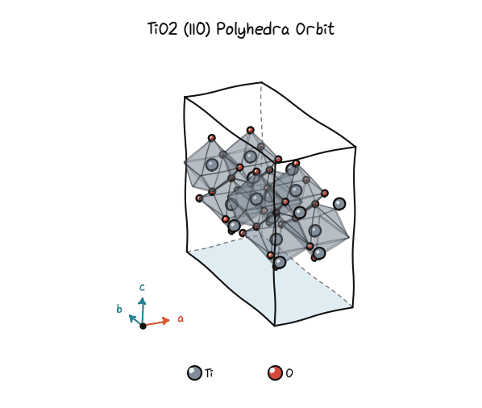 | 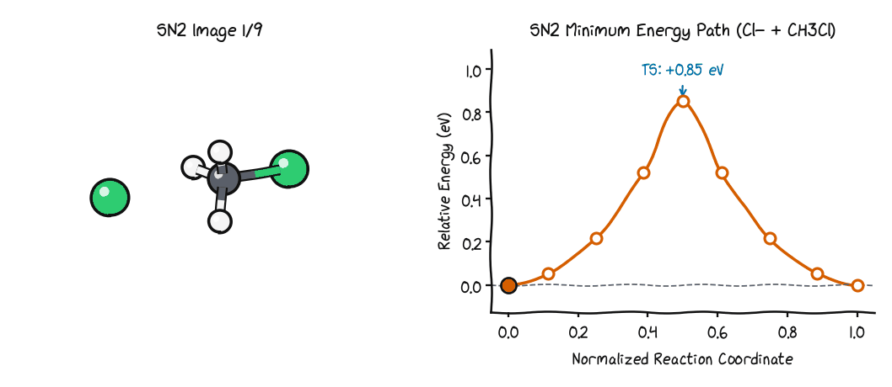 | 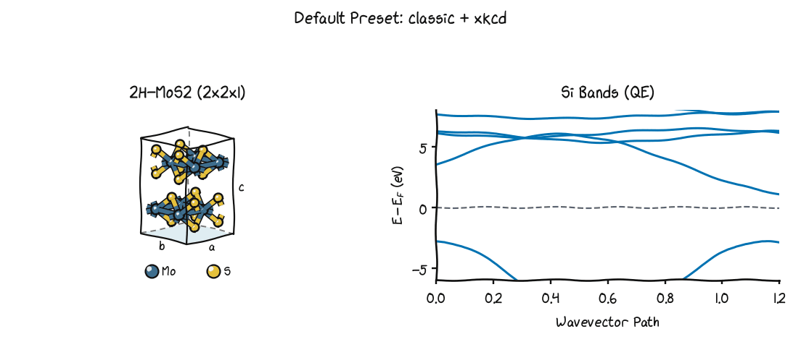 |

## Full Multi-Domain Showcase

A quick overview spanning molecules, periodic crystals, electronic structure, spectroscopy, and thermodynamics in one view:

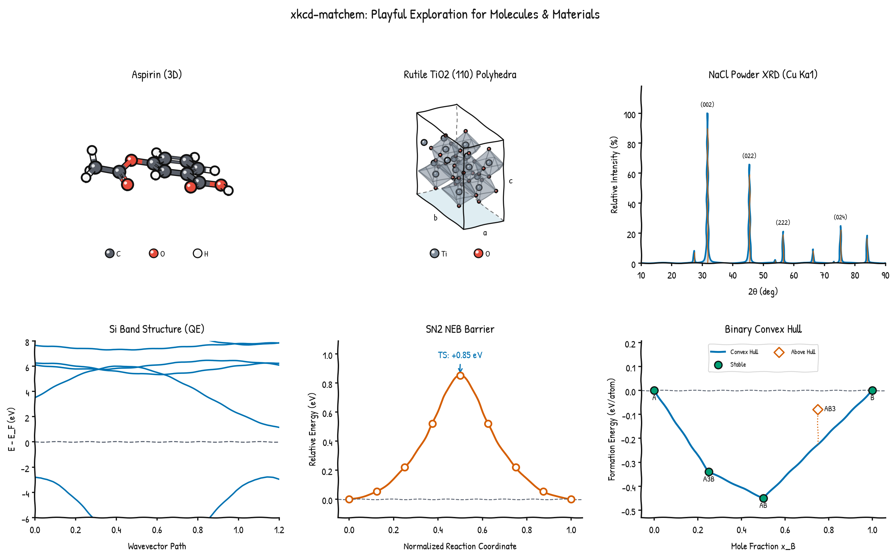

## Molecules: 3D Ball-and-Stick, Spacefill & 2D Skeletal

Compare `plot_molecule(..., style="ball_and_stick")`, `style="spacefill"`, and `mode="2d"` with automatic split half-bonds and inline element legends.
See [Tutorial 02: Molecules in 3D, 2D & Interactive Studio](tutorials/02_molecules_3d_and_2d.ipynb).

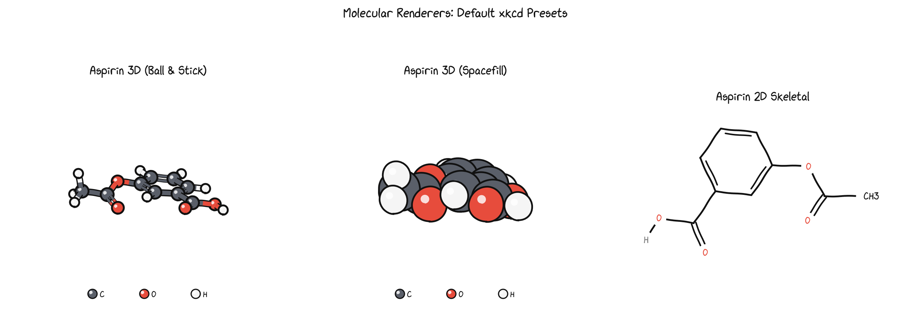

## Crystals, Slabs, Miller Planes & Powder XRD

Combine `plot_crystal()` (with `(111)` Miller slices and supercells), `plot_slab(..., view="side")` (automatic shaded slab/vacuum band detection for $\text{TiO}_2(110)$), `plot_coordination()`, and pure-NumPy $\text{Cu K}\alpha_1$ `plot_xrd()`.
See [Tutorial 03: Crystals, Slabs & Polyhedra](tutorials/03_crystals_slabs_and_polyhedra.ipynb).

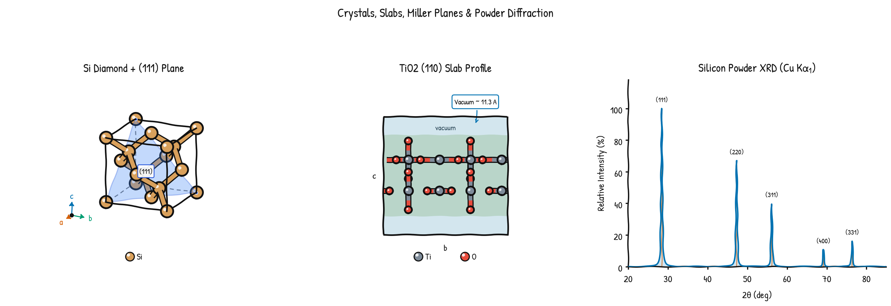

## Electronic Band Structure & Density of States

Fermi-aligned silicon bands and DOS parsed natively from Quantum ESPRESSO `bands.dat` and `dos.dat` via `plot_bands_dos()`.
See [Tutorial 04: Electronic Band Structures & DOS](tutorials/04_electronic_structure_bands_dos.ipynb).

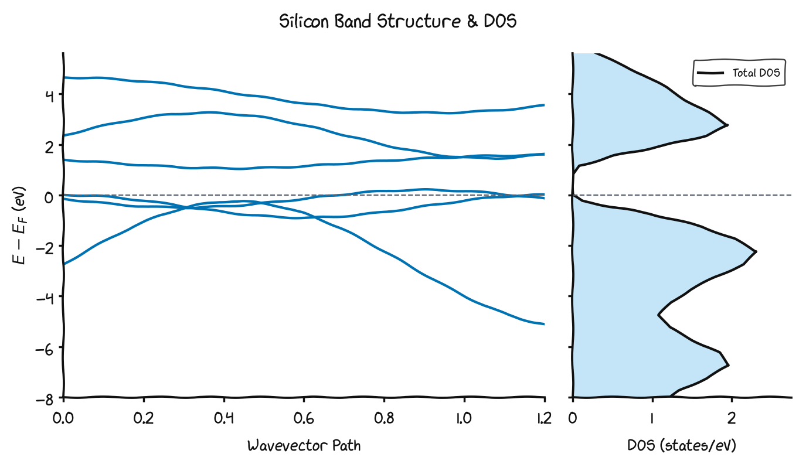

## Molecular Orbitals & Volumetric Charge Density

Pair ORCA molecular orbital energy ladders (`plot_mo_diagram()`) with affine-accurate 2D slices of Gaussian `.cube` volumetric grids (`plot_volumetric_slice()`).
See [Tutorial 05: Molecular Orbitals & Volumetric Cubes](tutorials/05_orbitals_and_volumetric_cubes.ipynb).

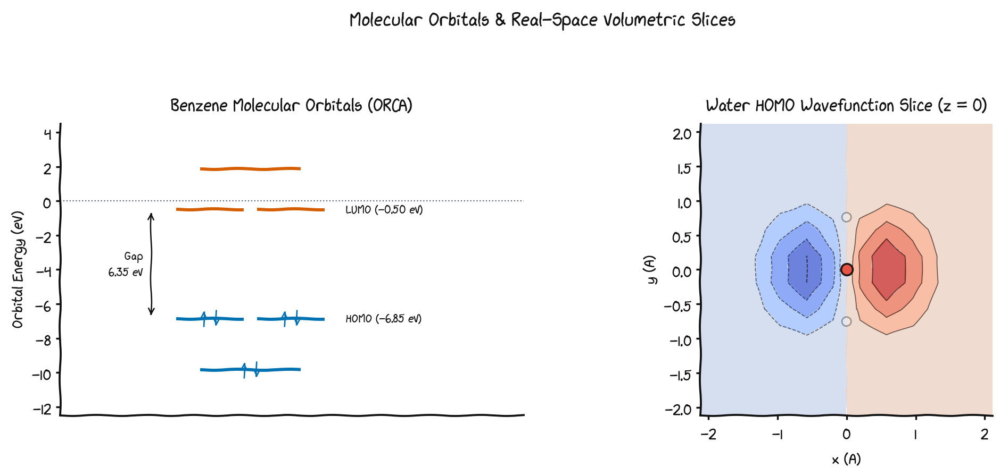

## IR & UV-Vis Spectra (Exploratory Sketches)

Visualize Gaussian vibrational IR transitions and ORCA TDDFT UV-Vis peaks with `plot_spectrum()` and customizable line broadening.
See [Tutorial 06: Spectroscopy & Powder XRD](tutorials/06_spectroscopy_and_powder_xrd.ipynb).

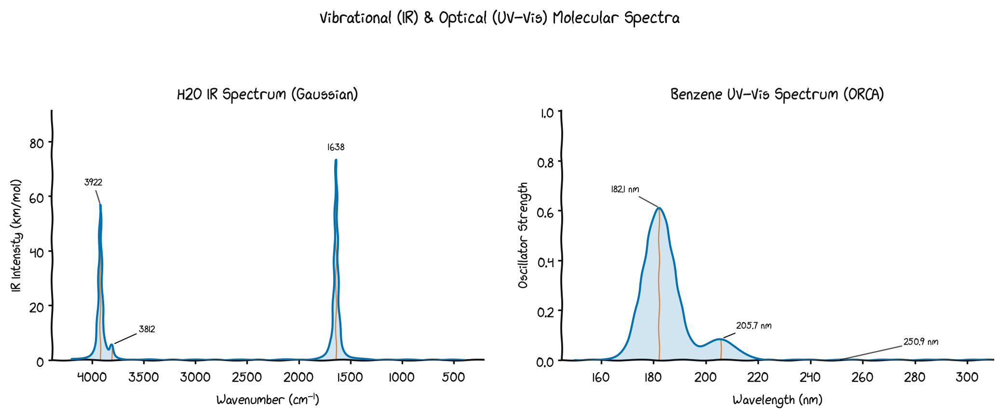

## Reaction Energy Profiles & Climbing-Image NEB

Sketch multi-step catalytic profiles (`plot_reaction_profile()`) alongside spline-interpolated minimum-energy pathways (`plot_neb()`) in eV or kcal/mol.
See [Tutorial 07: Reaction Pathways & NEB](tutorials/07_reaction_pathways_and_neb.ipynb).

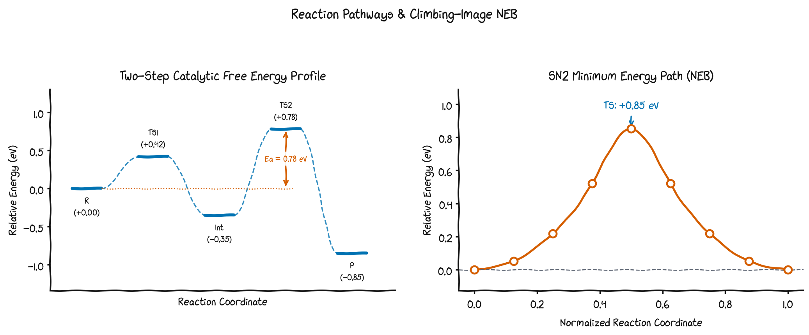

## Molecular Dynamics RMSD & Radial Distribution

Plot unwrapped periodic MD RMSD traces (`plot_md_timeseries()`) and radial distribution functions (`plot_rdf()`) from LAMMPS and GROMACS outputs.
See [Tutorial 08: MD Trajectories & RDF](tutorials/08_md_trajectories_and_rdf.ipynb).

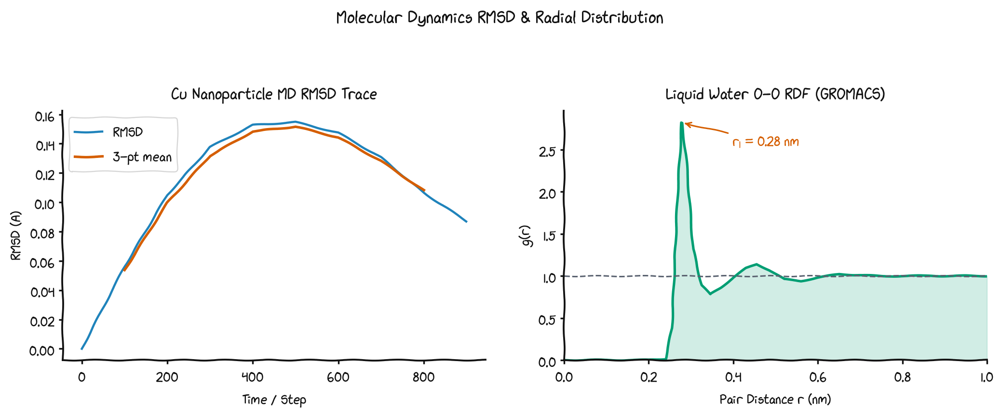

## Convex Hull, Equations of State & ML Parity

Bring together binary stability hulls (`plot_phase_diagram_2d()`), third-order Birch-Murnaghan EOS fits (`plot_eos()`), and ML interatomic potential benchmarks (`plot_parity()`).
See [Tutorial 09: Thermodynamics & ML Parity](tutorials/09_thermodynamics_and_ml_parity.ipynb).

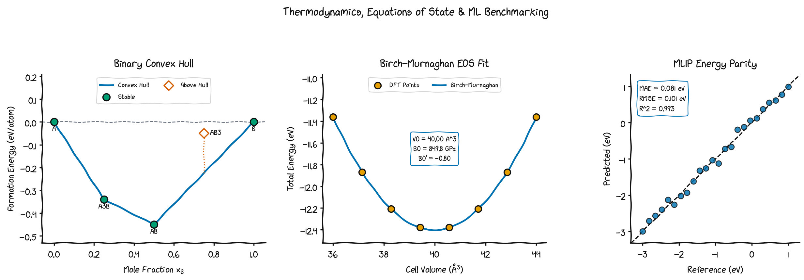

## Opt-In Poster Composition (`Board`, `Container`, `Card`, `Badge`)

Individual plots always stay borderless on an open canvas. When assembling a full conference poster or group-meeting handout in millimeter coordinates, opt into `xm.Board` — see [Tutorial 10: Opt-In Poster Boards & Interoperability](tutorials/10_posters_boards_and_interoperability.ipynb):

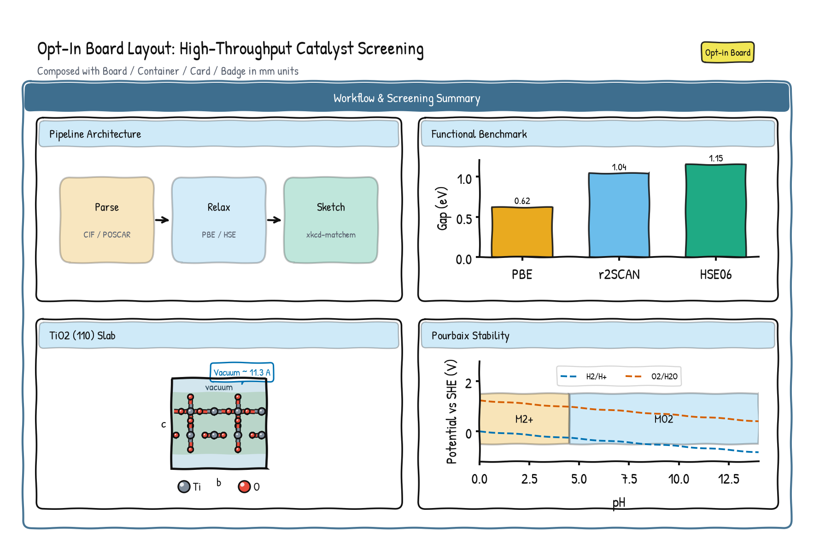
