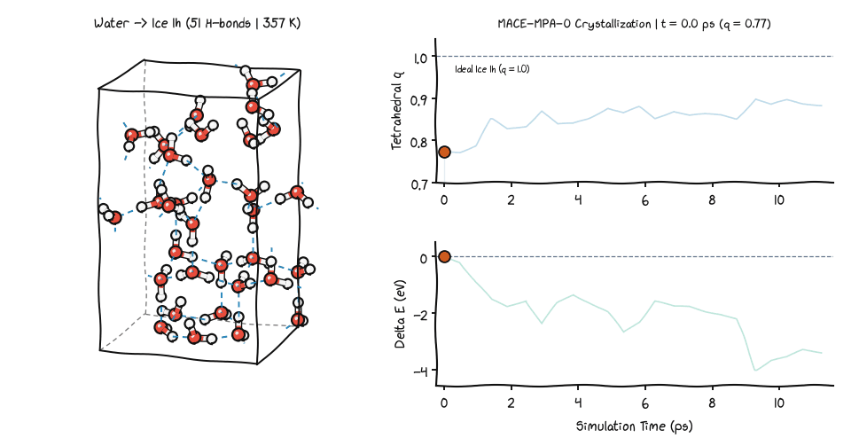

# xkcd-matchem: An xkcd-Style Visualization Suite for Chemistry and Materials Science Communication

Welcome to the documentation book for **`xkcd-matchem`** — a playful, clean-looking, xkcd-style Python library for visualizing molecules, crystals, surfaces, electronic structure, spectra, reactions, and molecular dynamics trajectories.

Built for students, educators, and researchers, it turns chemistry and materials science figures into clear, approachable **science communication (scicomm)** for lectures, group talks, and conference posters — with 29 zero-dependency file readers and an offline Interactive 3D Studio.

| 3D Coordination Polyhedra Orbit | MACE-MPA-0 Water → Ice Ih MD | Climbing-Image NEB Pathway |
| :---: | :---: | :---: |
|  |  |  |
| *Orbiting TiO₆ coordination octahedra with depth-sorted faces* | *Seeded direct-coexistence MLIP ice growth with H-bonds & order q(t)* | *Animating a 9-image SN2 reaction path into a looping GIF* |

## Pick Your Starting Point

Not sure where to jump in? Choose the path that fits what you want to do right now:

- **Want to try it without writing code?** Open the **[Interactive 3D Studio](playground.md)** right inside this documentation to spin 9 curated scenes (starting with a cross-hatched 3D water HOMO orbital), test all 8 pen-and-ink shading modes, swap atom colors, build supercells, and copy ready-to-run Python snippets.
- **Want to browse what's possible first?** Flip through the **[Visual Gallery](gallery.md)** — every figure links directly to the tutorial notebook that builds it.
- **Ready to plot your own files?** Follow **[Installation](installation.md)**, then work through **Basic Usage** (Tutorials 01, 02, 03, 04, and 06) for one-line defaults across themes, molecules, crystals and slabs, electronic band structures/DOS, vibrational/optical spectra, and powder XRD.
- **Customizing a talk, poster, or simulation workflow?** Jump to **Advanced Usage** (Tutorials 05 and 07–15) for molecular orbitals & volumetric cubes, NEB reaction barriers, periodic MD/RDF analysis, convex hulls & Birch-Murnaghan EOS fits, millimeter poster boards (with stacked cards and vintage parchment scrolls), the 118-element xkcd periodic table, background grids & hatched shading, matchem icons & GNN crystal graphs, 3D orbital isosurfaces, phonon dispersions, equilibrium Wulff crystal shapes, stick-scientist comic strips, Wigner–Seitz Brillouin zones, LOBSTER COHP bonding curves, Sabatier catalysis volcanos, semiconductor defect formation diagrams, crystal-field splitting, cyclic voltammetry & Tafel kinetics, battery `dQ/dV`, ¹H NMR multiplet trees, XPS Shirley deconvolution, turnkey SciComm layout templates (graphical abstracts, 16:9 talk slides, conference posters, and mechanism comics), looping MD/NEB/crystal-orbit/3D-isosurface GIF animations, and ASE/pymatgen/RDKit/cclib bridges.

:::{note}
**Defaults first, full control whenever you want it.**
Every plotter runs in a single line using balanced white-canvas defaults (`classic` preset, commercial-safe **SIL OFL 1.1 `Patrick Hand`** typography, borderless structure frames). Whenever you want to match a poster color scheme or dark slide deck, you can override individual element colors, cameras, backgrounds, fonts (including bundled `Comic Neue` under SIL OFL 1.1 or non-commercial opt-in `xm.use_xkcd_script()` under CC BY-NC 3.0), line wiggles, and reusable presets.
:::

:::{warning}
**Playful Exploration & SciComm vs. Journal Archival Figures**
Intentional xkcd-style stroke jitter makes slides, posters, and tutorials engaging and approachable. Because that wiggle can subtly soften sharp peak shoulders or fine numerical grid details, standard straight-line Matplotlib plots remain the better choice for archival journal spectra and quantitative peak fitting. Check the **[Capability & Validation Matrix](reference/capabilities.md)** to see which helpers are validated numerical algorithms vs. approximate models or educational illustrations.
:::

## How This Book Is Organized

1. **[Getting Started](installation.md)** — Install the core package (plus optional adapters), browse the visual gallery, or test-drive the offline 3D Studio.
2. **Basic Usage** — Hands-on notebooks focused on clean default presets for themes, molecules, crystals/slabs, band structures/DOS, and spectra/XRD.
3. **Advanced Usage** — Deeper customization, storytelling, and domain analysis covering orbitals/cubes, NEB transition-state barriers, triclinic MD & RDF, convex hulls & EOS fits, poster boards, the periodic table & GNN graphs, 3D isosurfaces/phonons/Wulff shapes/comic strips, Brillouin zones/COHP/volcanos/defects, crystal-field splitting/electrochemistry/NMR/XPS & turnkey SciComm layout templates, looping MD/NEB/orbit/isosurface GIF animations, and ecosystem bridges.
4. **[Reference](reference/capabilities.md)** — Feature capability & validation matrix, canonical internal units, native file format contracts & parser limits, searchable API reference, citation metadata, and full MLIP/data attributions.
