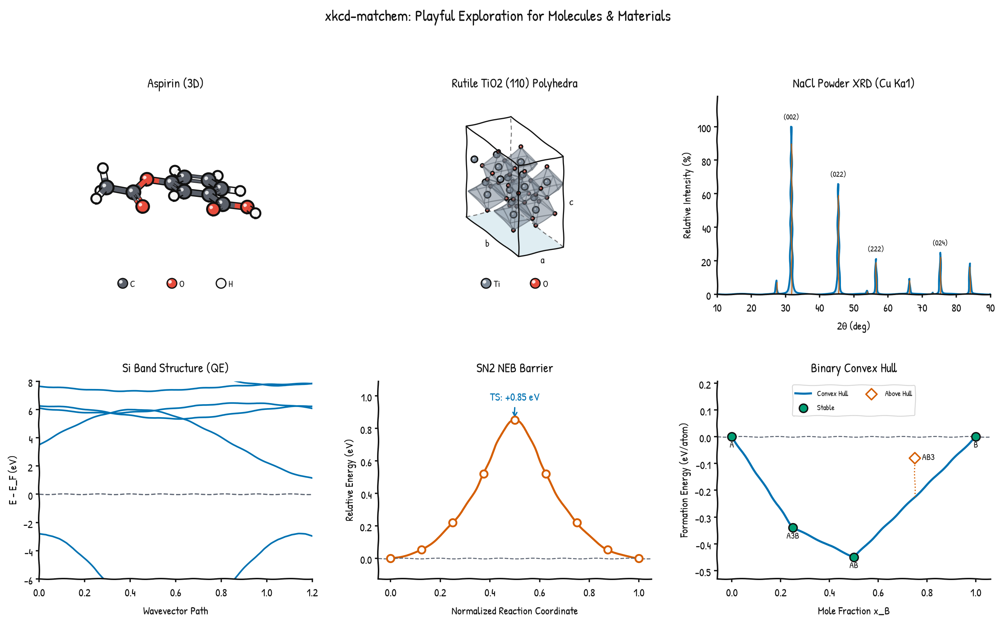
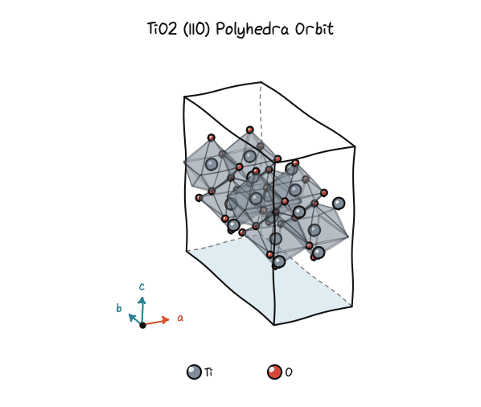
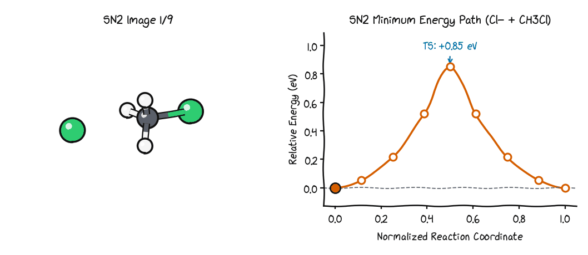
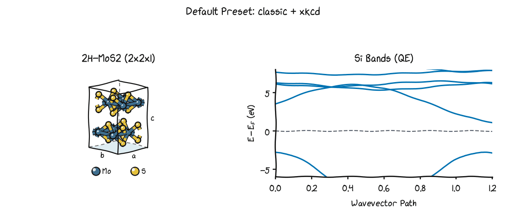

# xkcd-matchem: An xkcd-Style Visualization Suite for Chemistry and Materials Science Communication

Welcome to the documentation book for **`xkcd-matchem`** — a playful, clean-looking, xkcd-style Python library for visualizing molecules, crystals, surfaces, electronic structure, spectra, reactions, and molecular dynamics trajectories.

What began as a small helper to bring some xkcd comic charm to a conference poster grew into an open toolkit for students, educators, and researchers who want their **science communication (scicomm)**, lectures, group meetings, and posters to feel clear, lively, and memorable.

| 3D Coordination Polyhedra Orbit | Climbing-Image NEB Pathway | Live Theme & Palette Switching |
| :---: | :---: | :---: |
|  |  |  |

## Pick Your Starting Point

Not sure where to jump in? Choose the path that fits what you want to do right now:

- **Want to try it without writing code?** Open the **[Interactive 3D Studio](playground.md)** right inside this documentation to spin 9 curated scenes (starting with a cross-hatched 3D water HOMO orbital), test all 8 pen-and-ink shading modes, swap atom colors, build supercells, and copy ready-to-run Python snippets.
- **Want to browse what's possible first?** Flip through the **[Visual Gallery](gallery.md)** — every figure links directly to the tutorial notebook that builds it.
- **Ready to plot your own files?** Follow **[Installation](installation.md)**, then work through **Basic Usage** (Tutorials 01, 02, 03, 04, and 06) for one-line defaults across themes, molecules, crystals and slabs, electronic band structures/DOS, vibrational/optical spectra, and powder XRD.
- **Customizing a talk, poster, or simulation workflow?** Jump to **Advanced Usage** (Tutorials 05 and 07–14) for molecular orbitals & volumetric cubes, NEB reaction barriers, periodic MD/RDF analysis, convex hulls & Birch-Murnaghan EOS fits, millimeter poster boards (with stacked cards and vintage parchment scrolls), the 118-element xkcd periodic table, background grids & hatched shading, matchem icons & GNN crystal graphs, 3D orbital isosurfaces, phonon dispersions, equilibrium Wulff crystal shapes, stick-scientist comic strips, Wigner–Seitz Brillouin zones, LOBSTER COHP bonding curves, Sabatier catalysis volcanos, semiconductor defect formation diagrams, crystal-field splitting, cyclic voltammetry & Tafel kinetics, battery `dQ/dV`, $^1\mathrm{H}$ NMR multiplet trees, XPS Shirley deconvolution, turnkey SciComm layout templates (graphical abstracts, 16:9 talk slides, conference posters, and mechanism comics), and ASE/pymatgen/RDKit/cclib bridges.

:::{note}
**Defaults first, full control whenever you want it.**
Every plotter runs in a single line using balanced white-canvas defaults (`classic` preset, unified `xkcd Script` typography, borderless structure frames). Whenever you want to match a poster color scheme or dark slide deck, you can override individual element colors, cameras, backgrounds, fonts, line wiggles, and reusable presets.
:::

:::{warning}
**Playful Exploration & SciComm vs. Journal Archival Figures**
Intentional xkcd-style stroke jitter makes slides, posters, and tutorials engaging and approachable. Because that wiggle can subtly soften sharp peak shoulders or fine numerical grid details, standard straight-line Matplotlib plots remain the better choice for archival journal spectra and quantitative peak fitting.
:::

## How This Book Is Organized

1. **[Getting Started](installation.md)** — Install the core package (plus optional adapters), browse the visual gallery, or test-drive the offline 3D Studio.
2. **Basic Usage** — Hands-on notebooks focused on clean default presets for themes, molecules, crystals/slabs, band structures/DOS, and spectra/XRD.
3. **Advanced Usage** — Deeper customization, storytelling, and domain analysis covering orbitals/cubes, NEB transition-state barriers, triclinic MD & RDF, convex hulls & EOS fits, poster boards, the periodic table & GNN graphs, 3D isosurfaces/phonons/Wulff shapes/comic strips, Brillouin zones/COHP/volcanos/defects, crystal-field splitting/electrochemistry/NMR/XPS & turnkey SciComm layout templates, and ecosystem bridges.
4. **[Reference](reference/supported_formats.md)** — Exact native file format contracts, scientific geometry safeguards, searchable API reference, citation metadata, and data attributions.
